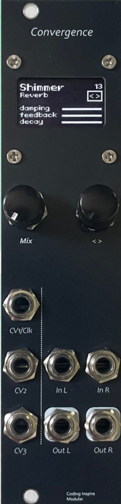
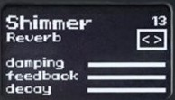

<H1>Convergence Digital Effects Processor User Manual</H1>

Software Version v2.0 Documentation Updated 2026-07-01

## I. Product Overview

Convergence is a high-performance digital effects processor module in Eurorack format, integrating 23 carefully designed audio effects across three categories: modulation, delay, and reverb. The module uses a DSP digital signal processor chip to provide professional-grade audio processing capabilities.

### Effect Categories

| Group | Effect Type | Number of Effects |
|------|----------|----------|
| PRESET | Modulation/Basic Effects | 7 |
| REVERB | Reverb Effects | 8 |
| DELAY | Delay Effects | 8 |

## II. Operating Instructions

### Product Photo

### 1. Hardware Controls

##### Mix Knob

Controls the dry/wet mix ratio of the effect. Turn clockwise to increase the proportion of the effect signal, or counterclockwise to increase the proportion of the original signal.

##### < > Knob

This knob supports two operations: rotating and pressing:

**Rotate**: Depending on the current editing state, changes the effect type or an effect parameter.

**Short Press**: Switches the knob's editing state, cycling through: Browse Mode → Parameter 1 → Parameter 2 → Parameter 3 → Browse Mode.

**Long Press**: In parameter editing mode, press and hold the knob while rotating it to fine-tune the current parameter value.

**Editing Mode Description:**

- **Browse Mode**: Rotate the knob to switch effect types. A cursor box appears around the < > icon to indicate that this mode is active.
- **Parameter 1 Mode**: Rotate the knob to adjust the value of Parameter 1. A cursor box appears on the Parameter 1 row.
- **Parameter 2 Mode**: Rotate the knob to adjust the value of Parameter 2. A cursor box appears on the Parameter 2 row.
- **Parameter 3 Mode**: Rotate the knob to adjust the value of Parameter 3. A cursor box appears on the Parameter 3 row.

### 2. Connector Descriptions

**CV1/CLK**: Control voltage input for Parameter 1. When the parameter is clk, a clock signal can be input to synchronize the delay time. Supports x1-x7 multipliers.

**CV2**: Control voltage input for Parameter 2. The modulation range is 0-5 V; voltage exceeding 5 V is automatically clipped.

**CV3**: Control voltage input for Parameter 3. The modulation range is 0-5 V; voltage exceeding 5 V is automatically clipped.

**InL**: Left-channel input.

**InR**: Right-channel input. When no input is connected to the right channel, the left-channel input signal is automatically copied to the right channel.

**OutL**: Left-channel output.

**OutR**: Right-channel output.

**CV Control Characteristics**: The CV signal is added to the knob value before being passed to the effect processor: `CV value + knob value = final parameter value`.

### 3. UI Description

The OLED display layout is shown below:

**Main Title (Top)**: The name of the current effect, such as Shimmer, Plate, or Delay.

**Subtitle (Below the Main Title)**: The effect category, such as reverb, modulation, or delay.

**Upper-Right Corner**: The current effect number (0-23).

**< > Icon**: Indicates the knob operating state. When the cursor box is on this icon, Browse Mode is active and the knob is used to switch effects.

**Parameters 1-3**: Display the names of the three adjustable parameters, with a parameter value progress bar or clock synchronization information shown on the right.

**Cursor Indication:**

- When the cursor box is on `< >`: Rotating the knob switches the effect type.
- When the cursor box is on a parameter row: Rotating the knob changes the value of that parameter.

### 4. Saving Preset Parameters

Convergence saves separate parameter settings for each effect, allowing you to quickly return to your previous effect settings.

**Automatic Save Mechanism:**

- After you adjust any parameter (Parameter 1, Parameter 2, or Parameter 3) in parameter editing mode, the system automatically saves the current effect's parameter configuration when you exit parameter editing mode.
- Save trigger condition: Saving is triggered when switching from parameter editing mode (cursor box on a parameter row) back to Browse Mode (cursor box on the `< >` icon).

**Storage Characteristics:**

- The three parameter values for each effect are saved independently and do not affect one another.
- Parameter values are retained after the device is powered off, and the previous settings are automatically restored the next time it is powered on.
- On first use, the default value of all effect parameters is the center position (50%).

**Operating Example:**

1. Select the "Shimmer" effect in Browse Mode.
2. Short-press the knob to enter Parameter 1 editing mode, then rotate it to adjust the parameter value.
3. Short-press the knob again to enter Parameter 2 editing mode, then rotate it to adjust the parameter value.
4. Continue short-pressing the knob until you return to Browse Mode. The system then automatically saves all parameter settings for the current effect.

## III. Effect Details

### Modulation/Basic Effects (PRESET)

### 1. Chorus

**A modulation effect that produces rich chorus by mixing multiple delayed signals with the original signal**

| Parameter | Function | Description |
|------|------|------|
| P1 - Reverb | Reverb Depth | Controls the amount of reverb in the chorus effect |
| P2 - Rate | Modulation Rate | Controls the LFO modulation frequency of the chorus |
| P3 - Mix | Dry/Wet Mix | Controls the mix ratio between the original signal and the effect signal |

### 2. Flanger

**A modulation effect that produces a comb-filtering effect by combining a short-delayed signal with the original signal**

| Parameter | Function | Description |
|------|------|------|
| P1 - Reverb | Reverb Depth | Controls the reverb component in the flanger effect |
| P2 - Rate | Modulation Rate | Controls the modulation frequency of the delay time |
| P3 - Mix | Dry/Wet Mix | Controls the mix ratio between the original signal and the effect signal |

### 3. Tremolo

**A modulation effect that produces a pulsating effect by periodically varying the volume**

| Parameter | Function | Description |
|------|------|------|
| P1 - Reverb | Reverb Depth | Controls the reverb component in the tremolo effect |
| P2 - Rate | Modulation Rate | Controls the frequency of the volume variation |
| P3 - Mix | Dry/Wet Mix | Controls the mix ratio between the original signal and the effect signal |

### 4. Tune Pitch Shift

**A pitch-shifting effect that changes the pitch of the input signal**

| Parameter | Function | Description |
|------|------|------|
| P1 - Tune | Pitch Shift Amount | Controls the amount of upward or downward pitch shift |
| P2 - --- | None | --- |
| P3 - --- | None | --- |

### 5. Tune Dly Pitch Delay

**Combines pitch shifting and delay effects**

| Parameter | Function | Description |
|------|------|------|
| P1 - Tune | Pitch Shift Amount | Controls the pitch shift of the delayed signal |
| P2 - Delay | Delay Time | Controls the length of the delay time |
| P3 - Mix | Dry/Wet Mix | Controls the mix ratio between the original signal and the effect signal |

### 6. By Pass

**No effect processing; the signal passes through directly**

| Parameter | Function | Description |
|------|------|------|
| P1 - --- | None | --- |
| P2 - --- | None | --- |
| P3 - --- | None | --- |

### 7. ReverbI

**Basic reverb effect**

| Parameter | Function | Description |
|------|------|------|
| P1 - Time | Reverb Time | Controls the reverb decay time |
| P2 - HF Loss | High-Frequency Loss | Controls the amount of high-frequency attenuation in the reverb |
| P3 - LF Loss | Low-Frequency Loss | Controls the amount of low-frequency attenuation in the reverb |

### 8. ReverbII

**Advanced reverb effect that provides a richer sense of space**

| Parameter | Function | Description |
|------|------|------|
| P1 - Time | Reverb Time | Controls the reverb decay time |
| P2 - HF Loss | High-Frequency Loss | Controls the amount of high-frequency attenuation in the reverb |
| P3 - LF Loss | Low-Frequency Loss | Controls the amount of low-frequency attenuation in the reverb |

---

### Reverb Effects (REVERB)

### 9. Spring Reverb

**Emulates a classic spring reverb effect with dual-head tape delay**

| Parameter | Function | Description |
|------|------|------|
| P1 - Time | Delay Time | Controls the tape delay time, with a range of approximately 60-487 ms |
| P2 - Feedback | Feedback Amount | Controls the delay feedback intensity, affecting the number of echo repeats |
| P3 - Reverb | Reverb Level | Controls the output level of the spring reverb |

**Description**: This effect emulates the classic RE301 spring reverb unit and includes two delay heads (Head 2 and Head 3), with Wow & Flutter effects simulating the speed fluctuations of a tape machine.

### 10. Plate Reverb

**Dattorro algorithm-based plate reverb with variable-frequency pitch shifting**

| Parameter | Function | Description |
|------|------|------|
| P1 - Shift | Pitch Shift | Controls the frequency shift amount of the input and feedback signals |
| P2 - Reverb | Reverb Time | Controls the reverb decay time, with a maximum value approaching infinite sustain |
| P3 - HF Loss | High-Frequency Loss | Controls high-frequency damping in the reverb loop |

**Description**: Uses the algorithm from Jon Dattorro's "Effect Design" paper, including an input diffusion network and a dual-loop reverb structure. Supports pitch shifting to produce a Shimmer effect.

### 11. Reverse Reverb

**Stereo reverse reverb effect with unique diffusion and filtering controls**

| Parameter | Function | Description |
|------|------|------|
| P1 - Time | Reverb Time | Controls the reverb decay time, with a range of 0.2-0.9 |
| P2 - Diffusion | Diffusion Amount | Controls the diffusion coefficient of the input all-pass filters, with a range of 0-0.7 |
| P3 - Decay LF | Low-Frequency Decay | Controls low-frequency filtering during reverb decay |

**Description**: Uses a single-loop structure. Each channel contains three variable-diffusion all-pass filters and one fixed-coefficient all-pass filter.

### 12. Hall Reverb

**Large hall reverb effect with pre-delay control**

| Parameter | Function | Description |
|------|------|------|
| P1 - Pre-delay | Pre-delay Time | Controls the delay from the input signal to the start of the reverb, with a range of 0-100 ms |
| P2 - Time | Reverb Time | Controls the reverb decay time |
| P3 - Damping | Damping | Controls the low-pass filter coefficient for high-frequency attenuation |

**Description**: Includes a 100 ms pre-delay buffer and a multi-layer initial delay structure, producing rich early reflections through multiple taps.

### 13. Rainbow Reverb

**Dattorro reverb with a fixed one-octave pitch shift**

| Parameter | Function | Description |
|------|------|------|
| P1 - Shift | Pitch Shift Level | Controls the mix level of the pitch-shifted signal |
| P2 - Time | Reverb Time | Controls the reverb decay time |
| P3 - HF Loss | High-Frequency Loss | Controls high-frequency damping in the reverb loop |

**Description**: Adds a fixed +1 octave pitch shift to the Dattorro reverb structure, producing a rainbow-like tone similar to Shimmer.

### 14. Shimmer Reverb

**Hall reverb with feedback pitch shifting, creating an angelic tone**

| Parameter | Function | Description |
|------|------|------|
| P1 - Damping | Damping | Controls the mix ratio of high-pass and low-pass filtering in the reverb loop |
| P2 - Feedback | Feedback Amount | Controls the feedback intensity of the pitch-shifted signal |
| P3 - Decay | Decay Time | Controls the reverb decay time, with a range of 0.3-0.95 |

**Description**: Pitch-shifts the reverb output up by +1 octave and feeds it back to the input, creating continuously rising high-frequency overtones. Commonly used in ambient music production.

### 15. Space Reverb

**A combined echo and reverb effect that creates a deep sense of space**

| Parameter | Function | Description |
|------|------|------|
| P1 - Time | Delay Time | Controls the echo delay time, with a range of 100-700 ms |
| P2 - Repeat | Number of Repeats | Controls the echo feedback intensity and number of repeats |
| P3 - Reverb | Reverb Level | Controls the output level of the reverb effect |

**Description**: Combines a long 22,938-sample delay with a dual-loop reverb structure. The echo filter coefficient is dynamically adjusted according to the feedback amount.

### 16. Room345 Room Reverb

**Three-tap room reverb that provides a compact sense of space**

| Parameter | Function | Description |
|------|------|------|
| P1 - Scale | Scaling | Controls the scaling ratio of the delay times |
| P2 - Feedback | Feedback Amount | Controls the feedback intensity of the three taps |
| P3 - ThreeTap | Three-Tap Mix | Controls the mix ratio of the three delay taps |

**Description**: Uses three delay lines of different lengths (0, 5,242, and 11,792 samples) to simulate the early reflections of a room.

---

### Delay Effects (DELAY)

### 17. Delay

**Classic analog-style delay effect**

| Parameter | Function | Description |
|------|------|------|
| P1 - clk | Delay Time | Controls the delay time, up to approximately 840 ms |
| P2 - Feedback | Feedback Amount | Controls the delay feedback intensity |
| P3 - Mix | Dry/Wet Mix | Controls the mix ratio between the original signal and the delayed signal |

**Description**: Features exponential-mapping delay time control, a high-pass filter to prevent low-frequency buildup, and a soft-clipping limiter to prevent overload.

### 18. Echo

**Echo effect with reverb**

| Parameter | Function | Description |
|------|------|------|
| P1 - Reverb | Reverb Level | Controls the reverb component in the echo |
| P2 - Delay | Delay Time | Controls the echo delay time, with a range of 50-600 ms |
| P3 - Level | Echo Level | Controls the output level of the echo signal |

**Description**: Combines a 20,000-sample delay line with a dual-loop reverb structure. The echo output is processed through a low-pass filter.

### 19. PingPong Delay

**Stereo cross-delay effect**

| Parameter | Function | Description |
|------|------|------|
| P1 - clk | Delay Time | Controls the delay time, up to approximately 670 ms |
| P2 - Feedback | Feedback Amount | Controls the cross-feedback intensity between the left and right channels |
| P3 - Damping | Damping | Controls high-pass and low-pass filtering in the feedback loop |

**Description**: Uses a dual delay-line structure. The left-channel output is fed back to the right-channel input, and the right-channel output is fed back to the left-channel input, creating echoes that alternate between left and right. Includes Wow & Flutter effects that emulate tape machine characteristics.

### 20. Starry Delay

**Delay effect with LFO modulation**

| Parameter | Function | Description |
|------|------|------|
| P1 - Time | Delay Time | Controls the base delay time |
| P2 - Feedback | Feedback Amount | Controls the delay feedback intensity |
| P3 - Damping | Damping | Controls the filter cutoff frequency |

**Description**: Includes LFO-modulated delay time variation and combines it with an SVF filter to produce a starfield-like shimmering effect.

### 21. Loop Looper

**Loop delay effect with recording and playback**

| Parameter | Function | Description |
|------|------|------|
| P1 - Delay Time | Delay Time | Controls the length of the loop delay time |
| P2 - Feedback | Feedback Amount | Controls the loop feedback intensity |
| P3 - Rec/Play | Record/Play | Controls switching between recording and playback modes |

**Description**: Supports switching between recording and playback modes, with fade-in/fade-out transitions to prevent pops. Uses a dual-tap ping-pong structure with fixed damping filtering.

### 22. Rnd Loop Random Loop

**Ping-pong delay with random jitter**

| Parameter | Function | Description |
|------|------|------|
| P1 - Time | Delay Time | Controls the delay time |
| P2 - Feedback | Feedback Amount | Controls the feedback intensity |
| P3 - Damping | Damping | Controls the amount of high-pass and low-pass filtering |

**Description**: Adds LFO-modulated delay time jitter (Wonkiness) to a standard ping-pong delay, creating an unstable, randomized effect.

### 23. Faux Analog Phaser

**Emulates a classic phaser effect**

| Parameter | Function | Description |
|------|------|------|
| P1 - LFO Rate | LFO Rate | Controls the modulation frequency |
| P2 - Delay Time | Delay Time | Controls the phasing depth |
| P3 - Feedback | Feedback Amount | Controls the feedback intensity of the phaser effect |

**Description**: Combines an LFO-modulated filter with a short delay to emulate the sonic characteristics of a classic analog phaser.

### 24. Vintage Delay

**Oil can delay effect with modulated jitter**

| Parameter | Function | Description |
|------|------|------|
| P1 - Time/Freq | Time/Frequency | Controls the delay time and modulation frequency |
| P2 - Depth | Modulation Depth | Controls the intensity of the jitter effect |
| P3 - Feedback | Feedback Amount | Controls the delay feedback intensity |

**Description**: Emulates a vintage Oil Can Delay effect with modulated delay time variation, creating a warm retro tone.

---

## IV. Technical Specifications

### 1. Dimensions

| Item | Specification |
|--------------|-------------------|
| Overall Dimensions | 128.5mm x 30.48mm |
| Eurorack Width | 6HP |
| Depth | Approximately 38mm |

### 2. Operating Information

| Item | Specification |
|--------------|-----------------------------------|
| Power Connector | 10-pin power connector |
| Protection Circuit | Includes reverse-polarity protection |
| +12V Current Requirement | 100ma |
| -12V Current Requirement | 10ma |
| Operating Platform | DSP |

### 3. Audio Specifications

| Item | Specification |
|--------------|-------------------|
| Sample Rate | 48000Hz (DSP) |
| Resolution | 16bit (internal 24bit) |
| Input Level Range | -10dB ~ +4dB |
| Output Level Range | -10dB ~ +4dB |

---

## V. Firmware Upgrade

Visit https://environscape.github.io/CodingInspire/support.html for the latest firmware information  
To upgrade the module, remove the rear mainboard, connect a USB cable, and use xLoader to upgrade the firmware. The upgrade file is in hex format.
