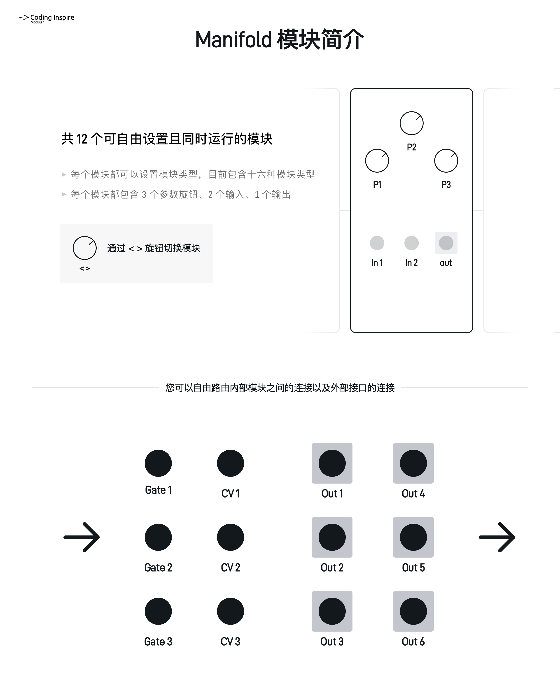
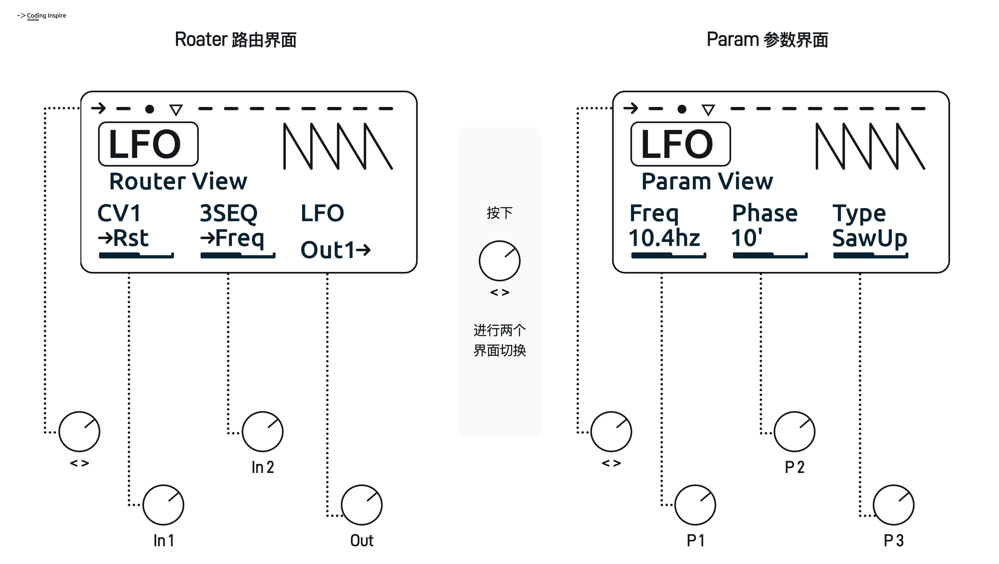
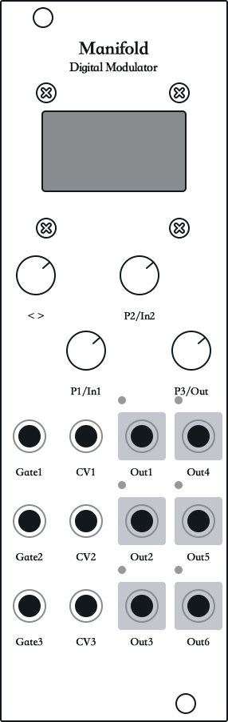
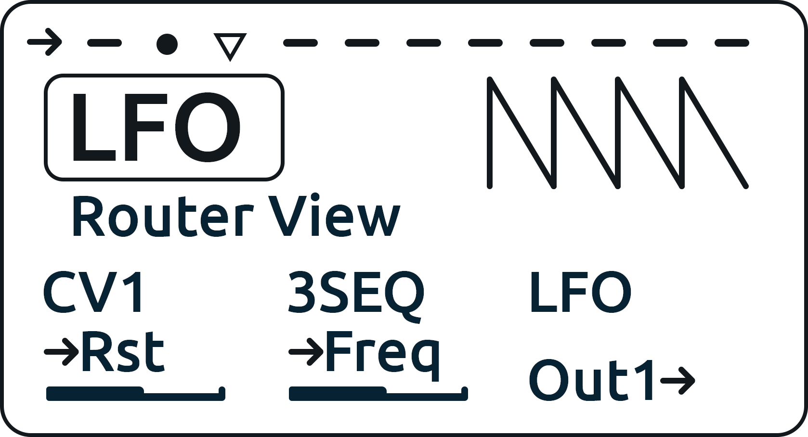
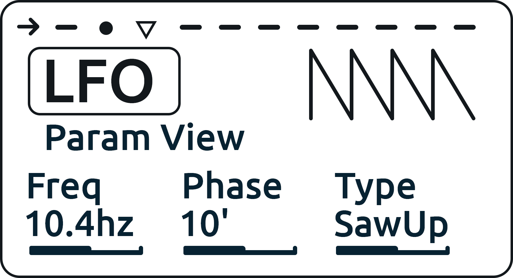
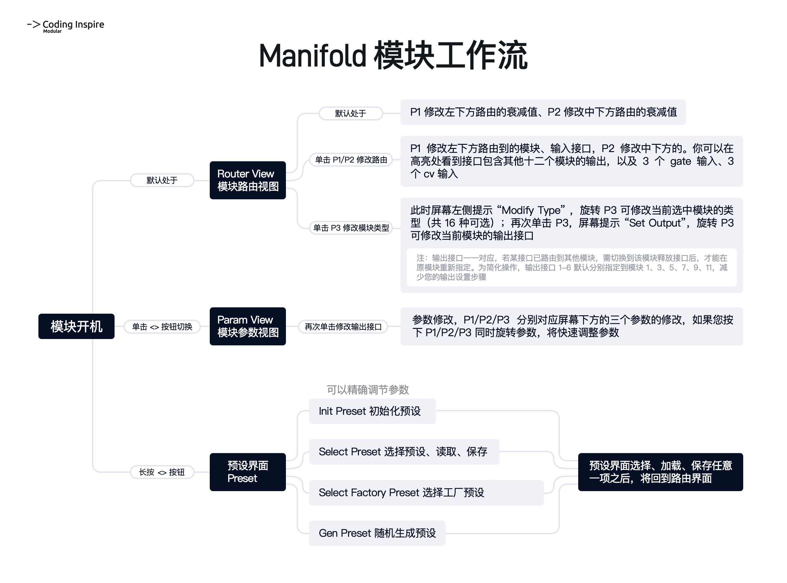
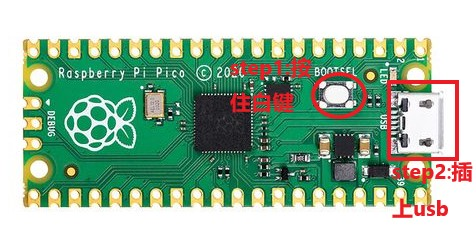

<H1>Manifold Integrated Digital Modulator User Manual</H1>

Software Version v1.10 — Document updated 2026-08-14

## 1. Quick Start

Manifold's operating logic is based on 12 parallel internal modulation modules and their parameters;  
you can freely route modulation between these internal modules as well as to and from the physical input/output jacks;  
each internal module has three parameters, two inputs, and one output.  

 
<figure>

    <figcaption>Module Overview</figcaption>
</figure>

<figure>

    <figcaption>Module Operation Overview</figcaption>
</figure>

## 2. Module Operation and Interface Details

 
<figure>

    <figcaption>Module Diagram</figcaption>
</figure>

### 1. <> Knob  

###### Turn
Used to switch between modules. There are twelve modules in total; the indicator at the top (see section 8. Screen - Module Indicators) shows which module you are currently on. Some modules start out empty, and you need to assign their type (see section 11. Screen - Router View).

###### Short Press
Used to toggle between the Router View and the Param View. In these two views, P1/P2/P3 each have different functions; they usually correspond to the three information areas at the bottom of the screen.

###### Long Press
Used to enter the Preset view. In this view's list you can save and load presets, initialize the module, and randomly generate presets (see section 13. Screen - Preset View).

### 2. P1/In1 Knob  

###### Turn
Usually adjusts the corresponding parameter shown at the bottom-left of the screen. In the Router View, turning it changes the attenuation of that routed input; in the Param View, turning it changes the corresponding parameter.

###### Short Press
In the Router View, a short press lets you edit the routing of the In1 jack; in the Param View it has no function.

###### Press and Turn
In the Param View, press and turn at the same time to adjust the parameter more quickly.

### 3. P2/In2 Knob  

###### Turn
Usually adjusts the corresponding parameter shown at the bottom-middle of the screen. In the Router View, turning it changes the attenuation of that routed input; in the Param View, turning it changes the corresponding parameter.

###### Short Press
In the Router View, a short press lets you edit the routing of the In2 jack; in the Param View it has no function.

###### Press and Turn
In the Param View, press and turn at the same time to adjust the parameter more quickly.

### 4. P3/Out Knob  

###### Turn
Usually adjusts the corresponding parameter shown at the bottom-right of the screen. In the Router View, turning it does not change anything; in the Param View, turning it changes the corresponding parameter.

###### First Short Press
In the Router View, the first short press lets you change the current module's type.

###### Second Short Press
In the Router View, the second short press lets you change the current module's output routing.

###### Press and Turn
In the Param View, press and turn at the same time to adjust the parameter more quickly.

### 5. Gate1-3 Input Jacks  

Jacks that accept high/low (gate) signals. You can route them as an input in the Router View; the input range is 0-10V.  
Internally, high and low levels are converted to 0 and 4095, with no intermediate values.

### 6. CV1-3 Input Jacks  

Jacks that accept control voltages. You can route them as an input in the Router View; the input range is 0-10V. Internally, a 0-10V level is converted to any value within 0-4095.  
You can also use these jacks to trigger Gate logic; the detection threshold is likewise about 2.5V.

### 7. Out1-6 Output Jacks  

Jacks that output control voltages. You can route them as an output in the Router View; the output range is 0-10V. Internally, any value between 0 and 4095 is converted to a 0-10V control level and sent out through the jack.  
Each output jack has a small LED at its upper left to indicate the output level. In Manifold's firmware, Gate outputs and CV outputs are both treated as 0-4095 values, so both can use these jacks.  

 
<figure>
    
    <figcaption>Main Screen - Router View</figcaption>
</figure>

### 8. Screen - Module Indicators    

Shows which module you are currently editing and gives a quick overview of module status. Twelve icons correspond to the twelve modules; each icon can take four shapes representing different states:  

###### Inverted Triangle   
Indicates the module you are currently editing among the twelve modules.  

###### Horizontal Line   
Indicates an empty slot where no module has been set yet.  

###### Right-Pointing Arrow   
Indicates an output module assigned to one of the Out1-6 jacks to output its signal.  

###### Filled Dot   
Indicates a module that has been created but is only used for internal modulation, with no output jack assigned.  

### 9. Screen - Top-Left Title    

Shows the name of the current module. In Manifold, every module is abstracted as a virtual module with 2 inputs, 1 output, and 3 knob-controlled parameters. The Router View and the Param View are where you adjust these 6 aspects of the current module.

### 10. Screen - Matrix Display    

Displays graphical information for the current module. For some modules it can visualize output waveforms or control content; others simply show animations such as faders or notes.    

### 11. Screen - Router View   

###### Basic Logic   
- Since the twelve internal modules are not directly connected, you route virtual patch cables between them in this view. Therefore, the order of the twelve modules does not matter.  
- When you are in the Router View (after short-pressing the <> knob), the bottom-left, bottom-middle, and bottom-right areas show which source is routed to the current module's In1, which source is routed to In2, and where the module's Out is routed,  
with a second line of text explaining what that connection does in the module.  
  
###### Setting the Current Module's Input Routing   
- For the two parameters at the bottom-left/bottom-middle, the first line of each shows where the module's input is routed; if nothing is connected, it displays "---".  
- The second line of each parameter shows what the input modulates inside the module; this differs by module type — see the per-module reference in Chapter 3.  
- To change the routed source, press P1/P2: the label below lights up, and turning P1/P2 then changes the routing of In1/In2.  
- In the routing list you will see: the names of modules 1-12 (usually the module number plus the module name — for example, 7LOGIC means the seventh module, named Logic, is routed to this input),  
as well as gate1-3 and cv1-3, indicating those physical jacks are routed to this module's In1/In2.  
- Finally, press P1/P2 again; the label returns from lit to dim, indicating that you have exited input routing setup.  
  
###### Setting Input Attenuation   
- Every input has an attenuator. While the bottom-left/bottom-middle labels are not lit, simply turn P1/P2 to adjust the attenuation amount;  
- If you are in routing-edit mode with the label highlighted, press the corresponding P1/P2 knob once more to return to attenuation mode.  
- Below each parameter there is an attenuation indicator that shows the attenuation level.  

###### Setting the Current Module's Type   
- The bottom-right parameter (P3 knob) changes the module type. Short-press P3: the screen highlights P3's type field, and turning P3 then changes the current module's type.  
- After changing the type — or without changing it — short-press P3 again to enter output routing setup.

###### Setting the Current Module's Output Routing   
- While in module-type mode, short-press P3 again: the screen highlights P3's output routing field, where you can change the module's output routing.  
- In the output routing list you will see the Out1-6 jacks plus a "---" option. When "---" is shown, the module does not output to any physical jack and is used for internal modulation only.  
- For convenience, modules 1/3/5/7/9/11 are mapped by default to Out1/Out2/Out3/Out4/Out5/Out6.    
- Once an Out jack is taken, it cannot be selected again, because output jacks are one-to-one.  
- If you need a jack that is already occupied, find the module occupying it and set it to "---" or another jack to release it.  

###### Returning P3 to Its Initial State   
- On the next short press, P3 cycles back to its initial state, where it changes nothing — this prevents an accidental turn from easily changing the module's type or output routing.  

 
<figure>
    
    <figcaption>Main Screen - Param View</figcaption>
</figure>

### 12. Screen - Param View  

When you are in the Param View (after short-pressing the <> knob), the bottom-left, bottom-middle, and bottom-right areas show the current module's Parameter 1, Parameter 2, and Parameter 3.  
The first line of each parameter shows what it controls inside the module; this differs by module type — see the per-module parameter reference in Chapter 3.  
The second line shows the parameter's current value, so you can quickly check the module's state.   
Turning P1/P2/P3 directly adjusts the three corresponding parameters;  
to balance adjustment speed and precision, press P1/P2/P3 while turning to adjust the corresponding parameter more quickly.

### 13. Screen - Preset View  

When you enter the Preset view by long-pressing the <> knob, you can press or turn the other knobs to trigger the functions shown at the bottom of the Preset screen, including preset selection, saving, and loading.  

###### Preset Storage   
The module has sixteen storage slots; each slot saves the parameters and routing of all twelve modules.  

###### Initialization   
The Preset view includes an Init Preset function located above the 16 user presets in the list; select it to initialize the module's parameters.  

###### Random Preset Generation (Lab)  
The Preset view includes a Preset Gen function above Init Preset. It randomly generates twelve modules of arbitrary types and randomly routes their relationships — a great way to experiment and hunt for inspiration.  

###### Factory Presets   
Below the 16 user presets there is a series of factory presets, including artist presets and common utility setups, so you can quickly jump into specific modulation scenarios. More factory presets are on the way.  

###### Entering the Settings View   
In the Preset view, the bottom of the screen shows four function hints: back (<> knob), set (P1 knob), save (P2 knob), and load (P3 knob).  
Short-press P1 (the "set" hint) to enter the Settings View, where you can adjust Manifold's global parameters (see section 14. Screen - Settings View).

### 14. Screen - Settings View  

The Settings View is used to adjust Manifold's global parameters. These are independent of presets, stored in EEPROM, and loaded automatically at every power-on.  

###### Layout and Operation   
The Settings View looks like the Preset view: settings are shown as a list in the center of the screen, the currently selected item is highlighted in inverse video, and the items above and below are also visible for quick browsing.  
- Turn the <> knob to scroll up and down and select the setting you want to adjust.  
- Turn P3 to change the selected setting's value. For numeric parameters (e.g. Qunt Scale), P3 adjusts in small steps for precision; for list parameters (e.g. Def Router), P3 cycles through the options.  
- P1 and P2 do not modify values in this view; P2 is used to save and exit (see below).  
- The bottom of the screen shows the button hints: back (<> knob, exit without saving), ---- (P1, no function), save (P2, save and exit), ---- (P3, no function).  

###### Exit and Save   
- Short-press the <> knob (the "back" hint): exit without saving; all changes are discarded, the values from EEPROM are restored, and you return to the Router View.  
- Short-press P2 (the "save" hint): save and exit; all current settings are written to EEPROM and you return to the Router View.  
- Both options exit back to the Router View.  

###### Setting Reference   

**Qunt Scale**: Calibration multiplier for the quantizer (QUNT) module's VOCT output. Default 1.000.  
If your quantizer's output pitch is offset relative to external gear, fine-tune this value to calibrate the VOCT voltage. It takes effect on the quantizer immediately — no preset reload needed.  

**Def Router1**: Default routing for In1 when a module is initialized. Default: Gate1.  
Options: 1MD-12MD (the twelve internal modules), Gate1-3, CV1-3, and ---- (no routing).  
When you run Init Preset, every module's In1 is routed to the source specified here. If that default points to an internal module that happens to be the module itself, the firmware avoids the self-loop and routes to Gate1 instead.  

**Def Router2**: Default routing for In2 when a module is initialized. Default: CV1.  
Options are the same as Def Router1.  
When you run Init Preset, every module's In2 is routed to the source specified here, with the same self-loop avoidance.  

**Boot Select**: The preset loaded automatically at power-on. Default: Init (load nothing, keep the initialized state).  
Options:  
1.Init — initialized state, no preset loaded  
2.User 1-16 — auto-load the corresponding user preset at boot  
3.FTY 1-16 — auto-load the corresponding factory preset at boot  
4.Gen — randomly generate a preset at boot  
After setting this and saving, Manifold will automatically load your chosen preset on the next power-on — no manual action needed.  

 
<figure>

    <figcaption>Module Workflow</figcaption>
</figure>

## 3. Module Reference

You can switch between modules at any time with the <> knob. When you are on a module, consult the sections below to understand its parameters and modulation targets.

### 1. LFO Low-Frequency Oscillator

**A basic low-frequency oscillator with a range of 0.1-20 Hz and five selectable waveforms**

##### Routing

**RST**: A high level on this input syncs/resets the LFO's phase  
**Freq**: The input level controls the oscillator's frequency

##### Parameters

**Freq**: LFO frequency, 0.1 Hz-20 Hz  
**Phase**: Phase 0-360°; when reset, oscillation restarts from this phase  
**Type**: Waveform type: sine, triangle, square, falling sawtooth, rising sawtooth

### 2. ASR Envelope Generator

**A classic envelope generator whose Decay and Release can be voltage-controlled**

##### Routing

**Trig**: A rising edge on this input triggers the envelope  
**CV**: The input level controls the envelope's decay and release  

##### Parameters

**Attk**: Attack time, 1 ms-2 s  
**Sustain**: Level percentage held while the envelope is gated, 0-100%  
**Dec/Rel**: Release time  

### 3. CLKDIV Clock Divider

**A clock divider. You can select any division value from 1 to 16, or use powers of two**

##### Routing

**CLK**: A rising edge on this input clocks the divider  
**RST**: A rising edge on this input triggers a reset  

##### Parameters

**---**:  
**Mode**: Division mode — any value from 0-16, or powers of two  
**Divide**: Division value — any value from 0-16, or powers of two

### 4. Logic

**This module provides four logic gate functions**

##### Routing

**In1**: Any input; for logic evaluation, levels above 2.5V count as True and below as False  
**In2**: Any input; evaluated against the same 2.5V True/False threshold

##### Parameters

**---**:  
**---**:  
**Type**: Four modes:  
AND: outputs True only when both inputs are True  
OR: outputs True when either input is True  
NOT: evaluates In1 only; outputs False when In1 is True, and True when In1 is False  
YES: evaluates In1 only; outputs True when In1 is True, and False when In1 is False  

### 5. SNH (S&H) Sample and Hold

**A sample & hold module: a Trig signal captures the current level, which is then held at the output until the next Trig; it also integrates a smoother and a jitter stage**

##### Routing

**Trig**: A rising edge triggers sampling of the Sign voltage. When SNH (Param1) is Off, this signal has no effect  
**Sign**: The voltage input

##### Parameters

**SNH**: On — enable sample & hold; In1's value is captured and held on In2's rising edge. Off — disable; In1's signal passes through directly  
**Smooth**: Smoothing amount; when non-zero, smooths the sampled (or direct In1) signal; 0 = no smoothing  
**Jitter**: Glitch amount; when non-zero, jitters the signal whether or not it was smoothed; 0 = no jitter

### 6. RNDOM Random

**A random module offering probability gating, random CV, random square-wave bursts, and random noise — each mode with an amount control**

##### Routing

**Trig**: This input accepts rising and falling edges  
**---**:  

##### Parameters

**---**:  
**Prob/Amt**: Prob — probability; Amt — variation amount  
**Mode**: Four modes:  
1.Gate — on a rising edge, outputs high with a probability set by Prob; on a falling edge, the output immediately goes low  
2.RndCV — on a rising edge, outputs a random level and holds it until the next trigger; Amt controls how wildly the level varies  
3.Bin — on a rising edge, outputs a square wave at a random 0.1-16 Hz frequency and holds it until the next trigger; Amt controls how wildly the frequency varies  
4.Noise — ignores all inputs and outputs random values continuously; Amt controls how wildly the values vary  

### 7. GENSEQ Generative CV Sequencer

**A generative CV sequencer that builds a sequence from the minimum level / maximum level / step count; changing a range parameter regenerates the sequence**

##### Routing

**CLK**: On a rising edge above 2.5V, the sequencer advances one step  
**RST**: On a rising edge above 2.5V, the playhead position resets

##### Parameters

**Min RG**: Minimum level of the generated CV sequence  
**Max RG**: Maximum level of the generated CV sequence  
**Steps**: Total steps of the sequence, 1-16

### 8. Eucld Euclidean Sequencer

**A Euclidean rhythm sequencer**

##### Routing

**CLK**: On a rising edge above 2.5V, the sequencer advances one step; on a falling edge, the output returns to low. You can therefore use the clock's gate length to make the Euclidean sequence output long gates or short trigs  
**RST**: On a rising edge above 2.5V, the playhead position resets

##### Parameters

**Shift**: Rotation offset within the Euclidean pattern  
**Active**: Number of active (triggering) steps in the pattern
**Steps**: Total steps of the pattern, 1-16  

### 9. ARP Arpeggiator

**An arpeggiator module**

##### Routing

**Trig**: On a rising edge above 2.5V, one arpeggio note is output  
**VOCT**: Tracks the VOCT signal and uses it as the root note of the arpeggiated chord

##### Parameters

**Chord**: Arpeggiated chord type  
**Mode**: Arpeggio mode — Up, Down, Up&Down, Random  
**Oct**: Octave range, 1-4 octaves

### 10. Beati Binary Rhythm Sequencer

**(Experimental) This module generates a rhythm from the binary bits of the P1 and P3 parameters; the step count is also adjustable**

##### Routing

**CLK**: On a rising edge above 2.5V, the sequencer advances one step; on a falling edge, the output returns to low. You can therefore use the clock's gate length to make the sequence output long gates or short trigs  
**RST**: On a rising edge above 2.5V, the playhead position resets

##### Parameters

**P1**: Rhythm pattern parameter 1  
**P3**: Rhythm pattern parameter 2
**Steps**: Total steps of the sequence, 1-16  

### 11. MIX

**This module mixes two input signals, with gain control per input plus a master output gain**

##### Routing

**In1**: Signal 1 to be mixed  
**In2**: Signal 2 to be mixed

##### Parameters

**Gain1**: Gain for signal 1, 0-2x  
**Gain2**: Gain for signal 2, 0-2x  
**Master**: Gain for the final mixed output

### 12. FADER Crossfader

**This module crossfades between two input signals to create specific modulation effects**

##### Routing

**In1**: Signal 1 to be crossfaded  
**In2**: Signal 2 to be crossfaded

##### Parameters

**Gain1**: Gain for signal 1  
**Cross**: Crossfade position between signal 1 and signal 2  
**Gain2**: Gain for signal 2

### 13. VCA Voltage-Controlled Amplifier

**A voltage-controlled amplifier, typically used to shape relationships between CVs**

##### Routing

**CV**: The VCA's control input  
**In**: The signal input being controlled

##### Parameters

**---**:
**Offset**: Bias applied to the control input  
**Atten**: Attenuation of the control input  

### 14. Invert Signal Inverter

**This module maps the input to a 0-4095 value and inverts it according to the Amt parameter**

##### Routing

**Sign**: The signal to be inverted  
**---**:  

##### Parameters

**---**:  
**---**:
**Amt**: Inversion amount applied to the input signal  

### 15. Qunt Quantizer

**This module quantizes the input signal to a selected scale; you can also set the scale's root note and a pitch offset applied to the final output**

##### Routing

**Trig**: Triggers quantization of the signal  
**Sign**: The signal to be quantized

##### Parameters

**Root**: Root note of the quantization scale  
**Scale**: Scale type — twelve scales available  
**Offset**: Semitone offset applied to the final output pitch, ±12 semitones

### 16. OVERFL Stack Overflow

**This module is great for glitch effects. The input signal is sliced into multiple sub-signals based on the program's memory size: feed it a rising ramp and you get a series of stepped rising signals; the same applies to falling signals**

##### Routing

**Sign**: Input signal  
**CV**: Voltage-controlled heap size; adds to the Heap parameter — the larger the value, the smaller the stack and the stronger the overflow effect

##### Parameters

**---**:
**Heap**: Heap size — the larger the value, the smaller the stack and the stronger the overflow effect  
**Mode**: Modes: 2^N — power-of-two heap size, up to 2048; Free — any heap size from 1-4095  

### 17. TIMER Metronome

**This module computes sixteenth-note intervals from the BPM and continuously outputs clock pulses. During playback, the matrix shows four dots marking the current sixteenth-note position, with the current dot filled; in the Param View, the State parameter shows the current bar and beat (e.g. 1/1). Start/stop can be controlled by a Gate input or manually**

##### Routing

**Gate**: A high level on this input starts playback, a low level stops it  
**RST**: A rising edge resets the playhead to bar 1, beat 1

##### Parameters

**BPM**: Tempo, 50-180  
**---**:  
**State**: Manual play control — a high value starts playback, a low value stops it (note: if started manually it only stops manually; if started by Gate it only stops by Gate)

(More internal module types will keep arriving — stay tuned)

## 4. Technical Specifications

### 1. Dimensions

| Item         | Specification      |
|--------------|-------------------|
| Faceplate    | 128.5mm x 40.64mm |
| Eurorack width | 8HP             |
| Depth        | approx. 24mm      |

### 2. Power and Platform

| Item         | Specification                      |
|--------------|-----------------------------------|
| Power connector | 10-pin power header            |
| Protection   | Reverse-polarity protection circuit |
| +12V current draw | 100mA                        |
| -12V current draw | 10mA                         |
| Platform     | Pico RP2040                       |

  
*Note: The module powers on over USB, but in that state it cannot output Eurorack-standard levels or receive CV input! Connect the module's power bus for proper input/output voltages!*

### 3. CV Output Specifications

| Item         | Specification      |
|--------------|-------------------|
| Sample rate  | 8kHz              |
| Resolution   | 12-bit            |
| Output level range | 0-10V        |

### 4. CV Input Specifications

| Item         | Specification      |
|--------------|-------------------|
| Sample rate  | 8kHz              |
| Resolution   | 12-bit            |
| Input level range | 0-10V         |

### 6. Expansion: I2C Expander

Coming soon

## 5. Firmware Update

<figure>

    <figcaption>Firmware update: hold the BOOT button while plugging in USB</figcaption>
</figure>

Visit https://environscape.github.io/CodingInspire/support.html for the latest firmware information.  
Hold the BOOT button on the Pico RP2040 before connecting USB to your computer, then plug the USB cable into your computer. A new drive will appear on your computer; drag the downloaded UF2 firmware file onto it. After about a minute, simply remove the USB cable and your Manifold module is updated.  
