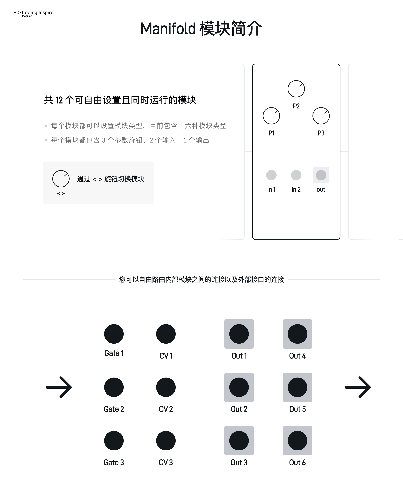
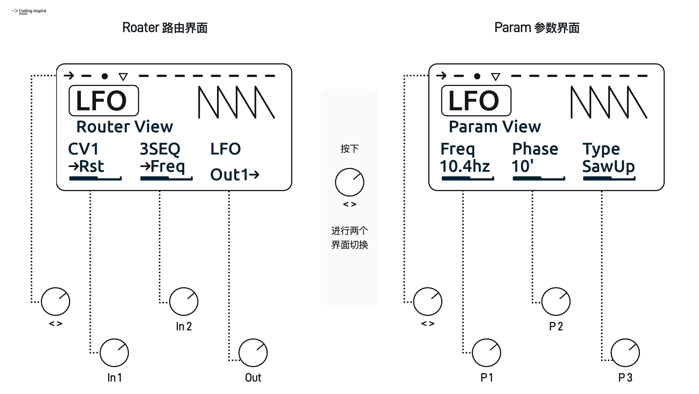
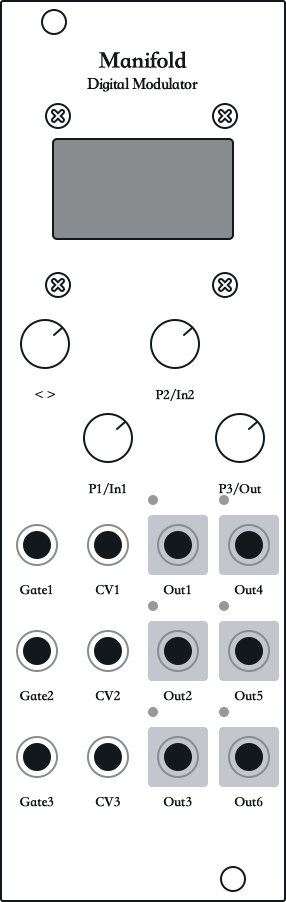
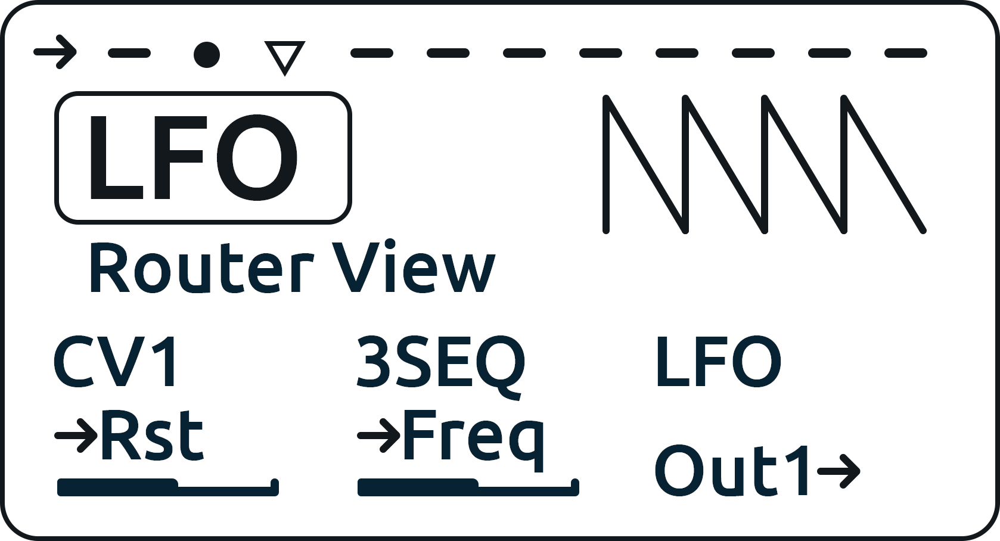
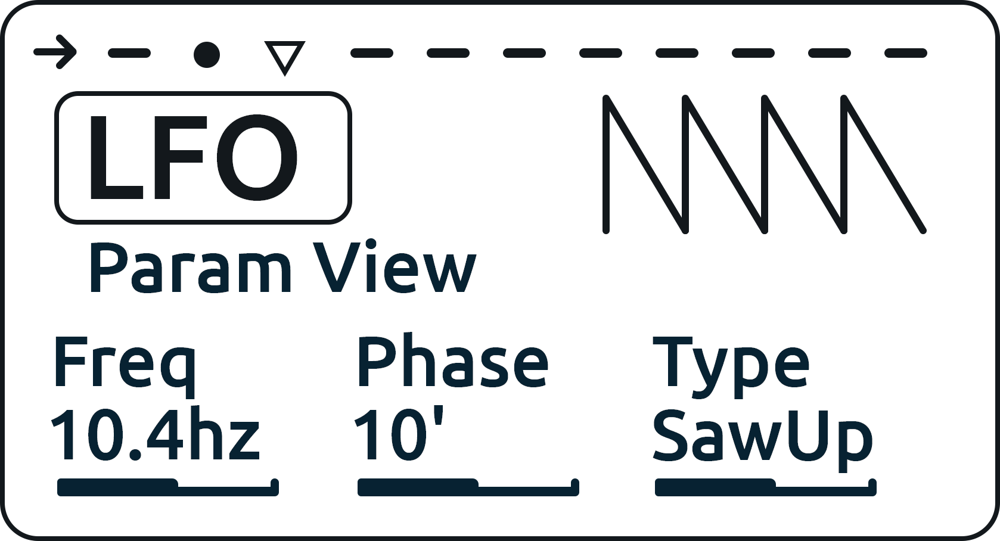
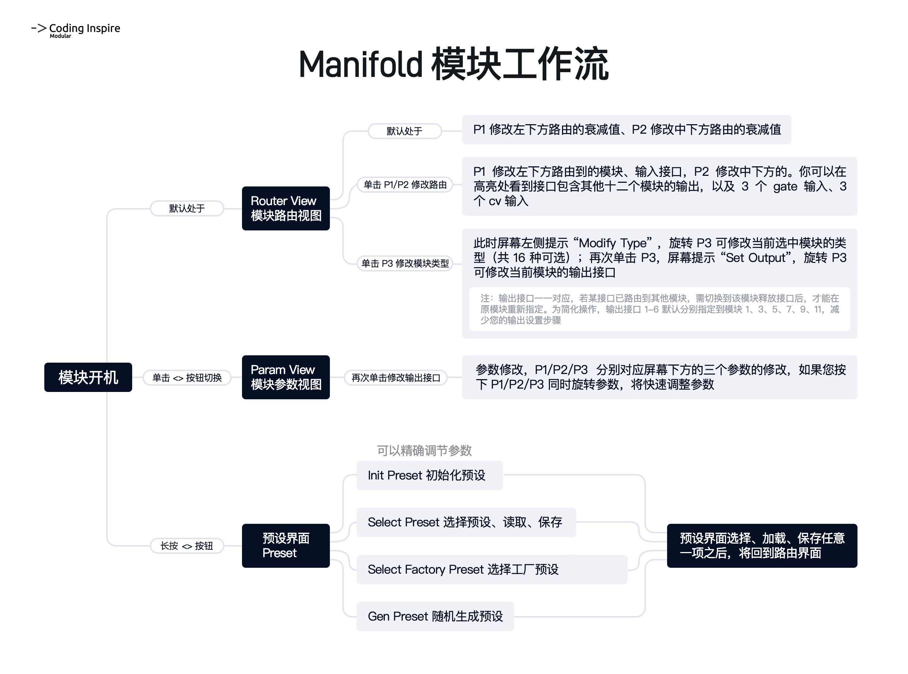
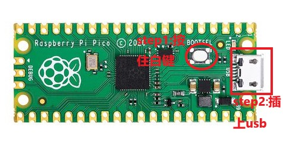

<H1>Manifold 統合型デジタルモジュレーター ユーザーマニュアル</H1>

ソフトウェアバージョン v1.10 ドキュメント更新日 2026-08-14

## 1. クイックスタート

Manifoldの操作ロジックは、12個の並列する内部モジュレーションモジュールとそのパラメータを基礎としています；  
これらの内部モジュール間のモジュレーション関係や、物理的な入出力ジャックを自由にルーティングできます；  
各内部モジュールは、3つのパラメータ、2つの入力、1つの出力を持ちます。  

 
<figure>

    <figcaption>モジュール概要</figcaption>
</figure>

<figure>

    <figcaption>モジュール操作の概要</figcaption>
</figure>

## 2. モジュール操作とインターフェース詳細

 
<figure>

    <figcaption>モジュール図</figcaption>
</figure>

### 1. <> ノブ  

###### 回転
モジュールの切り替えに使用します。全部で12のモジュールがあり、画面上部のインジケーター（第8項 画面 - モジュールインジケーター を参照）で現在位置を確認できます。一部のモジュールは最初は空のモジュールなので、タイプを指定する必要があります（第11項 画面 - Router View を参照）。

###### 短押し
ルーティング画面（Router View）とパラメータ画面（Param View）の切り替えに使用します。この2つの画面では、P1/P2/P3はそれぞれ異なる役割を持ち、通常は画面下部の3つの情報に対応して変更できます。

###### 長押し
プリセット画面（Preset）への遷移に使用します。この画面のリストでプリセットの保存・読み出しのほか、初期化やランダムなプリセット生成が行えます（第13項 画面 - Preset View を参照）。

### 2. P1/In1 ノブ  

###### 回転   
通常、画面左下に表示される対応するパラメータを変更します。ルーティング画面では回転によりその入力ルーティングの減衰量を変更し、パラメータ画面では対応するパラメータを変更します。

###### 短押し   
ルーティング画面では、短押し後にIn1ジャックのルーティングを変更できます。パラメータ画面では機能しません。

###### 押しながら回転   
パラメータ画面では、押しながら回転するとパラメータをすばやく調整できます。

### 3. P2/In2 ノブ  

###### 回転   
通常、画面中央下に表示される対応するパラメータを変更します。ルーティング画面では回転によりその入力ルーティングの減衰量を変更し、パラメータ画面では対応するパラメータを変更します。

###### 短押し   
ルーティング画面では、短押し後にIn2ジャックのルーティングを変更できます。パラメータ画面では機能しません。

###### 押しながら回転   
パラメータ画面では、押しながら回転するとパラメータをすばやく調整できます。

### 4. P3/Out ノブ  

###### 回転   
通常、画面右下に表示される対応するパラメータを変更します。ルーティング画面では回転しても何も変更されず、パラメータ画面では対応するパラメータを変更します。

###### 1回目の短押し   
ルーティング画面では、1回目の短押しで現在のモジュールタイプを変更できます。

###### 2回目の短押し   
ルーティング画面では、2回目の短押しで現在のモジュールの出力ルーティングを変更できます。

###### 押しながら回転   
パラメータ画面では、押しながら回転するとパラメータをすばやく調整できます。

### 5. Gate1-3 入力ジャック  

高低レベル（ゲート）信号を受け取るジャックです。ルーティング画面で入力として指定でき、入力範囲は0-10Vです。  
内部では、ハイ/ローレベルは0と4095に変換され、中間値はありません。

### 6. CV1-3 入力ジャック  

コントロール電圧を受け取るジャックです。ルーティング画面で入力として指定でき、入力範囲は0-10Vです。内部では0-10Vのレベルは0-4095の任意の値に変換されます。  
このジャックでゲートと同等のロジックをトリガーすることもでき、その検出しきい値も約2.5Vです。

### 7. Out1-6 出力ジャック  

コントロール電圧を出力するジャックです。ルーティング画面で出力として指定でき、出力範囲は0-10Vです。内部では0-4095の任意の値が0-10Vのコントロールレベルに変換され、このジャックから出力されます。  
各出力ジャックの左上には出力レベルを示す小さなLEDがあります。Manifoldのプログラムでは、ゲート出力とCV出力はどちらも0-4095の数値として扱われるため、どちらもこのジャックから出力できます。  

 
<figure>
    
    <figcaption>メイン画面 - Router View</figcaption>
</figure>

### 8. 画面 - モジュールインジケーター    

現在編集中のモジュールの位置と、各モジュールの状態の概要を表示します。12個のアイコンが12のモジュールに対応し、各アイコンは4つの形状で異なる状態を表します：  

###### 逆三角形のとき   
現在調整中のモジュールが12のモジュール中のどこにいるかを示します。  

###### 横線のとき   
まだモジュールが設定されていない空きスロットであることを示します。  

###### 右向き矢印のとき   
そのモジュールが出力モジュールであり、Out1-6のいずれかのジャックに割り当てられて信号を出力していることを示します。  

###### 塗りつぶしドットのとき   
モジュールは作成済みですが、内部モジュレーション専用で、出力ジャックには割り当てられていないことを示します。  

### 9. 画面 - 左上タイトル    

現在のモジュール名を表示します。Manifoldでは、すべてのモジュールは「2入力・1出力・3つのノブで制御する仮想モジュール」として抽象化されています。ルーティング画面とパラメータ画面で、この6つの項目を調整します。

### 10. 画面 - マトリクス表示    

現在のモジュールのグラフィカル情報を表示します。モジュールによっては出力波形や制御内容を具体的に表示し、別のモジュールではフェーダー/音符などのアニメーションを表示します。    

### 11. 画面 - Router View ルーティング画面   

###### 基本ロジック   
- 内部には12のモジュールがありますが、それらは直接接続されていないため、この画面で仮想パッチケーブルをルーティングします。したがって、12のモジュールの並び順は重要ではありません。  
- <>ノブを短押ししてルーティング画面にいるとき、左下・中央下・右下にはそれぞれ、現在のモジュールのIn1に接続されたソース、In2に接続されたソース、Outの出力先が表示され、  
2行目のテキストでその接続がモジュール内で何を行うかが示されます。  
  
###### 現在のモジュールの入力ルーティング設定   
- 左下/中央下の2つのパラメータについて、各1行目はモジュールの入力がどこにルーティングされているかを示し、未接続の場合は「---」と表示されます。  
- 各2行目は、その入力がモジュール内の何をモジュレートするかを示します。これはモジュールタイプごとに異なります。詳細は第3章の各モジュールのインターフェース説明を参照してください。  
- 接続先を変更するにはP1/P2を押してください。下のラベルが点灯し、P1/P2を回すことでIn1/In2のルーティングを変更できます。  
- ルーティングリストには、モジュール1-12の名前（通常はモジュール番号+モジュール名。例：7LOGICは、7番目のロジックと呼ばれるモジュールがこの入力に接続されていることを示します）、  
およびgate1-3・cv1-3の名前が表示され、これらの物理ジャックがこのモジュールのIn1/In2に接続されていることを示します。  
- 最後にもう一度P1/P2を押すと、ラベルが点灯から消灯に戻り、入力ルーティング設定を終了したことを示します。  
  
###### 入力減衰量の設定   
- すべての入力にはアテネーターが付いています。左下/中央下のラベルが点灯していない状態でP1/P2を回すと、減衰量を調整できます。  
- ラベルがハイライトされたルーティング編集状態のときは、対応するP1/P2をもう一度押すと減衰調整モードに戻ります。  
- 各パラメータの下には、減衰量を示すインジケーターがあります。  

###### 現在のモジュールタイプの設定   
- 右下のパラメータ（P3ノブ）はモジュールタイプの変更に使用します。P3を短押しすると画面にP3のタイプ項目がハイライトされ、P3を回すことで現在のモジュールタイプを変更できます。  
- タイプの変更後、または変更せずにそのままP3をもう一度短押しすると、出力ルーティング設定に進みます。

###### 現在のモジュールの出力ルーティング設定   
- モジュールタイプ設定の状態でP3をもう一度短押しすると、画面にP3の出力ルーティング項目がハイライトされ、現在のモジュールの出力ルーティングを変更できます。  
- 出力ルーティングの選択肢にはOut1-6のジャックと「---」があります。「---」が表示されているとき、そのモジュールは物理出力ジャックには出力せず、内部モジュレーション専用として使用されます。  
- 利便性のため、モジュール1/3/5/7/9/11はデフォルトでOut1/Out2/Out3/Out4/Out5/Out6にマッピングされています。    
- あるOutジャックがすでに使用されている場合、そのジャックを再選択することはできません。出力ジャックは1対1だからです。  
- 使用中のジャックが必要な場合は、そのジャックを占有しているモジュールを探し、「---」か別のジャックに変更して占有を解除してください。  

###### P3を初期状態に戻す   
- 次にP3を短押しすると、P3は初期状態へ循環して戻り、何も変更しなくなります。これにより、誤回転でモジュールのタイプや出力ルーティングが簡単に変わってしまうのを防ぎます。  

 
<figure>
    
    <figcaption>メイン画面 - Param View</figcaption>
</figure>

### 12. 画面 - Param View パラメータ画面  

<>ノブを短押ししてパラメータ画面にいるとき、左下・中央下・右下にはそれぞれ、現在のモジュールのパラメータ1・パラメータ2・パラメータ3が表示されます。  
各パラメータの1行目は、そのパラメータがモジュール内の何を制御するかを示します。これはモジュールタイプごとに異なります。詳細は第3章の各モジュールタイプのパラメータ説明を参照してください。  
2行目はパラメータの現在値で、モジュールの状態をすぐに確認できます。   
P1/P2/P3を回すと、対応する3つのパラメータを直接調整できます。  
調整速度と精度を両立するため、すばやく調整したい場合は、P1/P2/P3を押しながら回すと対応するパラメータを素早く調整できます。

### 13. 画面 - Preset View プリセット画面  

<>ノブを長押ししてプリセット画面に入ると、他のノブの押下や回転によって、プリセット画面下部に表示された対応する機能を呼び出せます。プリセットの選択・保存・読み出しが含まれます。  

###### プリセット保存   
モジュールには16の保存スロットがあり、各スロットには12のモジュールすべてのパラメータとルーティング状態が保存されます。  

###### 初期化   
プリセット画面には、リスト内の16プリセットの上にInit Preset機能があります。これを選択するとモジュールのパラメータを初期化できます。  

###### ランダムプリセット生成（ラボ）  
プリセット画面には、Init Presetの上にPreset Genランダム生成機能があります。任意のタイプのモジュールを12個ランダムに生成し、それらの関係もランダムにルーティングします。インスピレーション実験にぜひお試しください。  

###### ファクトリープリセット   
プリセット画面には、16プリセットの下に一連のファクトリープリセットがあります。アーティストプリセットやよく使われる機能を直接呼び出せ、特定のモジュレーションシーンにすばやく入ることができます。今後さらにファクトリープリセットが追加予定です。  

###### 設定画面への遷移   
プリセット画面では、画面下部に4つの機能ヒントが表示されます：back（<>ノブ）、set（P1ノブ）、save（P2ノブ）、load（P3ノブ）。  
P1ノブを短押しする（「set」ヒント）と設定画面（Setting View）に入り、Manifoldのグローバルパラメータを調整できます（第14項 画面 - Setting View を参照）。

### 14. 画面 - Setting View 設定画面  

設定画面はManifoldのグローバルパラメータを調整するための画面です。これらのパラメータはプリセットとは独立しており、EEPROMに保存され、電源投入のたびに自動で読み込まれます。  

###### 画面レイアウトと操作ロジック   
設定画面はプリセット画面と同じスタイルで、画面中央にリスト形式で設定項目が表示されます。現在選択中の項目は反転ハイライト表示され、上下の隣接項目も同時に表示されるため、すばやく閲覧できます。  
- <>ノブで上下にスクロールし、調整したい設定項目を選択します。  
- P3ノブで選択中の設定項目の値を変更します。数値型パラメータ（Qunt Scaleなど）はP3の回転で小さなステップで精密に調整でき、リスト型パラメータ（Def Routerなど）はP3の回転で選択肢を順に切り替えます。  
- この画面でP1とP2は値の変更には関与せず、P2は保存しての終了に使用します（下記参照）。  
- 画面下部のボタンヒント：back（<>ノブ、保存せず終了）、----（P1ノブ、機能なし）、save（P2ノブ、保存して終了）、----（P3ノブ、機能なし）。  

###### 終了と保存   
- <>ノブを短押し（「back」ヒント）：保存せずに終了します。すべての変更は破棄され、EEPROMの元の値に戻り、ルーティング画面に戻ります。  
- P2ノブを短押し（「save」ヒント）：保存して終了します。現在のすべての設定値をEEPROMに書き込み、ルーティング画面に戻ります。  
- いずれの方法でもルーティング画面（Router View）に戻ります。  

###### 設定項目詳細   

**Qunt Scale**：クァンタイザー（QUNT）モジュールのVOCT出力のキャリブレーション倍率。デフォルト値は1.000。  
クァンタイザーの出力ピッチが外部機器とずれている場合、この値を微調整してVOCT電圧を校正できます。このパラメータはクァンタイザーモジュールに即時反映され、変更後にプリセットを再読み込みする必要はありません。  

**Def Router1**：モジュール初期化時の入力1（In1）のデフォルトルーティング。デフォルトはGate1。  
選択範囲：1MD-12MD（12の内部モジュール）、Gate1-3、CV1-3、および----（ルーティングなし）。  
Init Preset（初期化）を実行すると、すべてのモジュールのIn1がこの設定で指定されたソースに自動的にルーティングされます。デフォルトルーティングが内部モジュールを指していて、たまたまそのモジュール自身と同じだった場合、プログラムは自己ループを避けて自動的にGate1へルーティングします。  

**Def Router2**：モジュール初期化時の入力2（In2）のデフォルトルーティング。デフォルトはCV1。  
選択範囲はDef Router1と同じです。  
Init Presetを実行すると、すべてのモジュールのIn2がこの設定で指定されたソースにルーティングされ、同様に自己ループ回避のロジックが働きます。  

**Boot Select**：電源投入時に自動で読み込むプリセット。デフォルトはInit（何も読み込まず、初期化状態を維持）。  
選択範囲：  
1.Init：初期化状態。プリセットを読み込まない  
2.User 1-16：起動時に対応するユーザープリセットを自動読み込み  
3.FTY 1-16：起動時に対応するファクトリープリセットを自動読み込み  
4.Gen：起動時にランダムなプリセットを生成  
この設定をして保存すると、次回の電源投入時にManifoldが指定されたプリセットを自動で読み込みます。手動操作は不要です。  

 
<figure>

    <figcaption>モジュールワークフロー</figcaption>
</figure>

## 3. 各モジュール機能詳細

<>ノブでいつでも複数のモジュールを切り替えられます。各モジュールの画面では、以下の説明を参照してパラメータとモジュレーション内容を確認してください。

### 1.LFO ローフリーケンシーオシレーター

**基本的なローフリーケンシーオシレーター（LFO）モジュールです。発振範囲は0.1-20Hz、5種類の波形から選択できます**

##### ルーティング設定

**RST**：ハイレベルを受けるとLFOの位相を同期/リセットします  
**Freq**：レベル値を受け、オシレーターの周波数を制御します

##### パラメータ設定

**Freq**：LFOの周波数。範囲0.1Hz-20Hz  
**Phase**：位相0-360°。リセット時、この位相から発振を開始します  
**Type**：波形タイプ：サイン波、三角波、矩形波、下降ノコギリ波、上昇ノコギリ波

### 2.ASR エンベロープジェネレーター

**伝統的なエンベロープジェネレーターですが、DecayとReleaseを電圧制御できます**

##### ルーティング設定

**Trig**：立ち上がりエッジでエンベロープの実行をトリガーします  
**CV**：レベル値でエンベロープのディケイおよびリリースを制御します  

##### パラメータ設定

**Attk**：エンベロープのアタックタイム 1ms-2s  
**Sustain**：エンベロープがトリガーされている間に保持するレベルの割合 0-100%  
**Dec/Rel**：リリースタイム  

### 3.CLKDIV クロックディバイダー

**クロックディバイダーです。1-16の任意の分周値、または2のn乗の値で分周できます**

##### ルーティング設定

**CLK**：立ち上がりエッジでクロックディバイダーをトリガーします  
**RST**：立ち上がりエッジでリセットをトリガーします  

##### パラメータ設定

**---**：  
**Mode**：分周値のモード。0-16の任意値、または2のn乗  
**Divide**：分周値。0-16の任意値、または2のn乗

### 4.Logic ロジック

**4種類のロジック機能を備えたモジュールです**

##### ルーティング設定

**In1**：任意の入力。ロジック判定では2.5V以上をTrue、未満をFalseとして扱います  
**In2**：任意の入力。同じ2.5VのTrue/Falseしきい値で判定されます

##### パラメータ設定

**---**：  
**---**：  
**Type**：4つのモード:  
AND: 両方がTrueのときのみTrueを出力します  
OR: どちらか一方でもTrueならTrueを出力します  
NOT: In1のみ判定。In1がTrueならFalseを、In1がFalseならTrueを出力します  
YES: In1のみ判定。In1がTrueならTrueを、In1がFalseならFalseを出力します  

### 5.SNH(S&H) サンプル＆ホールド

**サンプル＆ホールドモジュールです。Trig信号でその瞬間のレベル値を取得し、次のTrigの再トリガーまでその値を出力し続けます。スムーサーとジッターも統合されています**

##### ルーティング設定

**Trig**：立ち上がりエッジでSign電圧のサンプリングをトリガーします。SNH（パラメータ1）がOffのとき、この信号は機能しません  
**Sign**：電圧を受け取る入力です

##### パラメータ設定

**SNH**：On：サンプル＆ホールド有効。In2の立ち上がりエッジでIn1の入力信号を保持します。Off：サンプル＆ホールド無効。In1の信号をそのまま取得します  
**Smooth**：スムージング量。値があるとき、サンプル＆ホールドまたはIn1の信号をスムージングします。0のときはスムージングなし  
**Jitter**：ジッター量。値があるとき、Smooth処理の有無にかかわらず信号に急激な変化を加えます。0のときはジッターなし

### 6.RNDOM ランダム

**ランダムモジュールです。確率トリガー、ランダムレベル、ランダムな故障矩形波、ランダムノイズが可能で、各モードとも程度を制御できます**

##### ルーティング設定

**Trig**：この入力は立ち上がりエッジと立ち下がりエッジを受け付けます  
**---**：  

##### パラメータ設定

**---**：  
**Prob/Amt**：Prob：確率。Amt：変化の程度  
**Mode**：4つのモード:  
1.Gate：立ち上がりエッジ検出時、Probパラメータの確率でトリガーし、成功するとハイレベルを出力します。立ち下がりエッジ検出時は、ただちにローレベルへ戻ります  
2.RndCV：立ち上がりエッジ検出時、ランダムなレベルを出力し、次のトリガーまでそのレベルを出力し続けます。このときAmtパラメータは、レベル変化の激しさを表します  
3.Bin：立ち上がりエッジ検出時、0.1-16Hzのランダムな発振波の出力を開始し、次のトリガーまでその周波数を保持し続けます。このときAmtパラメータは、周波数変化の激しさを表します  
4.Noise：入力を一切検出せず、ランダム値を連続出力します。このときAmtパラメータは、ランダム値変化の激しさを表します  

### 7.GENSEQ ジェネレーティブCVシーケンサー

**ジェネレーティブCVシーケンサーです。最大レベル/最小レベル/ステップ数に基づいてシーケンスを生成します。範囲パラメータを変更するたびに、再生成がトリガーされます**

##### ルーティング設定

**CLK**：2.5V超の立ち上がりエッジを検出すると、シーケンサーは次のステップへ進みます  
**RST**：2.5V超の立ち上がりエッジを検出すると、再生ヘッドの位置がリセットされます

##### パラメータ設定

**Min RG**：生成されるCVシーケンスの最低レベル  
**Max RG**：生成されるCVシーケンスの最高レベル  
**Steps**：生成されるシーケンスの総ステップ数。設定範囲1-16

### 8.Eucld ユークリッドシーケンサー

**ユークリッドシーケンサーモジュールです**

##### ルーティング設定

**CLK**：2.5V超の立ち上がりエッジを検出すると、シーケンサーは次のステップへ進みます。立ち下がりエッジを検出すると出力はローレベルへ戻るため、クロックのゲート長を調整することで、ユークリッドシーケンスが長いGateを出力するか短いTrigを出力するかを間接的に切り替えられます  
**RST**：2.5V超の立ち上がりエッジを検出すると、再生ヘッドの位置がリセットされます

##### パラメータ設定

**Shift**：ユークリッドシーケンスのオフセット（回転量）  
**Active**：ユークリッドシーケンスでトリガーするステップの総数
**Steps**：ユークリッドシーケンスの総ステップ数。設定範囲1-16  

### 9.ARP アルペジエーター

**アルペジエーターモジュールです**

##### ルーティング設定

**Trig**：2.5V超の立ち上がりエッジを検出すると、1回のアルペジオを出力します  
**VOCT**：VOCT信号を検出し、アルペジオコードのルート音とします

##### パラメータ設定

**Chord**：アルペジオのコードタイプ  
**Mode**：アルペジオモード。Up、Down、Up&Down、Randomの4種  
**Oct**：オクターブ範囲 1-4オクターブ

### 10.Beati バイナリリズムシーケンサー

**（実験機能）P1とP3の2つのパラメータの2進ビットからリズムを生成します。ステップ数も設定できます**

##### ルーティング設定

**CLK**：2.5V超の立ち上がりエッジを検出すると、シーケンサーは次のステップへ進みます。立ち下がりエッジを検出すると出力はローレベルへ戻るため、クロックのゲート長で長いGateか短いTrigかを間接的に切り替えられます  
**RST**：2.5V超の立ち上がりエッジを検出すると、再生ヘッドの位置がリセットされます

##### パラメータ設定

**P1**：リズム生成パラメータ1  
**P3**：リズム生成パラメータ2
**Steps**：リズムシーケンスの総ステップ数。設定範囲1-16  

### 11.MIX ミックス

**2つの入力信号をミックスできます。各入力のゲインと出力のゲインを制御できます**

##### ルーティング設定

**In1**：ミックスする信号1  
**In2**：ミックスする信号2

##### パラメータ設定

**Gain1**：信号1のゲイン 0-2倍  
**Gain2**：信号2のゲイン 0-2倍  
**Master**：最終出力信号のゲイン調整

### 12.FADER クロスフェーダー

**2つの入力信号をクロスフェードさせ、特定のモジュレーション効果を作り出せます**

##### ルーティング設定

**In1**：ミックスする信号1  
**In2**：ミックスする信号2

##### パラメータ設定

**Gain1**：信号1のゲイン  
**Cross**：信号1と信号2のクロスフェード量  
**Gain2**：信号2のゲイン

### 13.VCA 電圧制御アンプ

**電圧制御アンプ（VCA）モジュールです。通常、CV同士の関係を処理するために使用します**

##### ルーティング設定

**CV**：VCAの制御入力  
**In**：制御される信号入力

##### パラメータ設定

**---**：
**Offset**：制御入力へのオフセット量  
**Atten**：制御入力の減衰量  

### 14.Invert インバーター

**入力信号を0-4095の対応する値とし、Amtパラメータに応じて信号値を反転します**

##### ルーティング設定

**Sign**：反転する信号入力  
**---**：  

##### パラメータ設定

**---**：  
**---**：
**Amt**：入力信号の反転量  

### 15.Qunt クァンタイザー

**入力信号を指定したスケールにクァンタイズします。スケールのルート音、および最終出力ピッチのオフセットも指定できます**

##### ルーティング設定

**Trig**：信号のクァンタイズをトリガーします  
**Sign**：クァンタイズする信号を入力します

##### パラメータ設定

**Root**：クァンタイズスケールのルート音  
**Scale**：クァンタイズするスケールタイプ。12種類のスケールを収録  
**Offset**：最終出力ピッチへの半音オフセット ±12半音

### 16.OVERFL スタックオーバーフロー

**グリッチ効果の制作に適したモジュールです。入力信号をプログラムのメモリサイズに基づいて複数のサブ信号に分割します。上昇スロープ信号を入力すると、複数の連続的に上昇する信号が得られます。下降信号も同様です**

##### ルーティング設定

**Sign**：入力信号  
**CV**：電圧制御のヒープサイズ。パラメータのヒープサイズと加算されます。値が大きいほどスタックが小さくなり、オーバーフロー効果が大きくなります

##### パラメータ設定

**---**：
**Heap**：ヒープサイズ。値が大きいほどスタックが小さくなり、オーバーフロー効果が大きくなります  
**Mode**：モード：2^N - 2のn乗のヒープサイズ（最大2048）。Free - 1-4095の任意値のヒープサイズ  

### 17.TIMER メトロノーム

**BPMから16分音符の間隔を計算し、クロックパルスを出力し続けます。再生中、マトリクスには4つのドットで現在の16分音符の位置が表示され、現在位置のドットが塗りつぶされます。パラメータ画面ではStateパラメータに現在の小節と拍数（例：1/1）が表示されます。Gate入力による start/stop と手動制御の両方に対応しています**

##### ルーティング設定

**Gate**：ハイレベルで再生を開始し、ローレベルで再生を停止します  
**RST**：立ち上がりエッジで再生位置を第1小節第1拍にリセットします

##### パラメータ設定

**BPM**：テンポ。範囲50-180  
**---**：  
**State**：手動での再生制御。パラメータ値が高いと再生を開始し、低いと再生を停止します（注意：手動で開始した場合は手動でのみ停止でき、Gateで開始した場合はGateでのみ停止します）

（今後も内部モジュールの実装が追加されていきます。お楽しみに）

## 4. 仕様

### 1. 寸法情報

| 項目         | 仕様              |
|--------------|-------------------|
| 外形寸法     | 128.5mm x 40.64mm |
| Eurorack幅   | 8HP               |
| 奥行き       | 約24mm            |

### 2. 電源・動作情報

| 項目               | 仕様                 |
|--------------------|----------------------|
| 電源コネクタ       | 10pin電源コネクタ    |
| 保護回路           | 逆接保護回路搭載     |
| +12V消費電流       | 100mA                |
| -12V消費電流       | 10mA                 |
| 動作プラットフォーム | Pico RP2040        |

  
*注意：USB給電でも電源は入りますが、Eurorack標準レベルの出力はできず、CV入力の受け付けもできません！正常な電圧の入出力には、モジュールの電源を接続してください！*

### 3. 電圧出力仕様

| 項目             | 仕様    |
|------------------|---------|
| サンプルレート   | 8kHz    |
| 分解能           | 12bit   |
| 出力レベル範囲   | 0-10V   |

### 4. 電圧入力仕様

| 項目             | 仕様    |
|------------------|---------|
| サンプルレート   | 8kHz    |
| 分解能           | 12bit   |
| 入力レベル範囲   | 0-10V   |

### 6. 拡張デバイス I2Cエキスパンダー

Coming soon

## 5. ファームウェアのアップデート

<figure>

    <figcaption>ファームウェアアップデート手順：BOOTボタンを押しながらUSBを接続</figcaption>
</figure>

最新のファームウェア情報は、https://environscape.github.io/CodingInspire/support.html をご覧ください。  
コンピューターにUSB接続する前にPico RP2040のBOOTボタンを押したままUSBを接続してください。コンピューターに新しいディスクが現れたら、ダウンロードしたUF2ファームウェアファイルをそこへドラッグします。約1分待ってからUSBを取り外せば、Manifoldモジュールのアップデートは完了です。  
