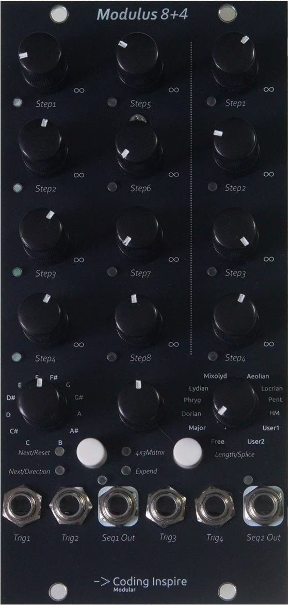
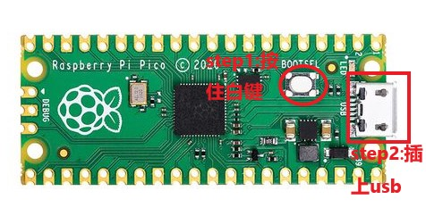

<center><H1>Modulus8+4 Dual Sequencer Module User Manual</H1></center>

<center>Software Version: v1.0 | Document Updated: 2026-07-22</center>

## 1. Product Overview

Modulus8+4 is a dual-track sequencer module in Eurorack format. It integrates two independent sequencer tracks (Track 1 with 8 steps and Track 2 with 4 steps) and supports three operating modes, scale quantization, splice/length control, and matrix navigation mode. Based on the Pico RP2040 processor, the module provides high-precision analog outputs and a 4×3 LED matrix status display.

### Core Features

| Feature | Description |
|------|------|
| Sequencer | Track 1: eight steps + Track 2: four steps, with 12 independent CV values in total |
| Operating Modes | 3 modes (Step/Direction/Matrix) |
| Quantization | 12 scales + 12 selectable root notes |
| Splice Mode | Track 1 and Track 2 can be spliced into a continuous 12-step sequence |
| Matrix Mode | Maps Track 1 + Track 2 to a 4×3 matrix, supporting up, down, left, and right navigation |
| Output Precision | High-precision analog output covering approximately 6.6 octaves |
| Status Display | 4×3 LED matrix indicates the current step and mode in real time |

## 2. Module Operation and Interface Details



### 1. Knobs

The module has 15 knobs for setting sequencer parameters and quantization options:

##### Track 1 Knobs (8)

Control the CV values of the eight steps on Track 1. Turning a knob clockwise increases the output level (approximately 0–6.6V), corresponding to a pitch range of approximately 6.6 octaves.

**Random Trigger**: When a knob is turned close to its maximum value, triggering that step outputs a random value. If scale quantization is also enabled, the random value is limited to the valid notes in the selected scale.

##### Track 2 Knobs (4)

Control the CV values of the four steps on Track 2, with the same behavior as Track 1.

##### Length/Splice Knob

- **Length mode** (toggle switch up): Controls the active length of Track 1 (1–8 steps).
- **Splice mode** (toggle switch down): Controls the splice cut point between Track 1 and Track 2 (1–11), combining the two sequences into one 12-step sequence. Track 1 occupies the first N steps, and Track 2 occupies the remaining (12−N) steps.

##### Root Knob

Selects the root note of the quantization scale, with 12 options (C, C#, D, D#, E, F, F#, G, G#, A, A#, B).

##### Scale Knob

Selects the quantization scale, with 12 options:

| Position | Scale Name | Description |
|------|----------|------|
| 0 | Bypass | No quantization; outputs the knob value directly |
| 1 | Ionian | Natural major |
| 2 | Dorian | Dorian |
| 3 | Lydian | Lydian |
| 4 | Phrygian | Phrygian |
| 5 | Mixolydian | Mixolydian |
| 6 | Aeolian | Natural minor |
| 7 | Locrian | Locrian |
| 8 | Harm.Min | Harmonic minor |
| 9 | Pent.Maj | Major pentatonic |
| 10 | User1 | User scale 1 (not yet available) |
| 11 | User2 | User scale 2 (not yet available) |

##### Tune Knob

Fine-tunes the global tuning multiplier over a range of 0.800–1.200×, allowing the module's pitch to be calibrated and aligned with other Eurorack equipment.

### 2. Gate Trigger Input Jacks

Four gate input jacks trigger sequencer steps. When a trigger signal is received, the corresponding operation is performed. The specific function depends on the current operating mode (see Section 3).

- **Trigger Input 1**: Track 1 primary function (advance step / move down in matrix)
- **Trigger Input 2**: Track 1 secondary function (reset step / reverse direction / move right in matrix)
- **Trigger Input 3**: Track 2 primary function (advance step / move up in matrix)
- **Trigger Input 4**: Track 2 secondary function (reset step / reverse direction / move left in matrix)

### 3. CV Output Jacks

Two analog output jacks with an output range of approximately 0–6.6V, corresponding to approximately 6.6 octaves under the 1V/Oct standard.

- **Output 1**: Track 1 output
- **Output 2**: Track 2 output (in Matrix mode, both outputs are identical)

### 4. Mode Button

Each press cycles the operating mode through Step mode → Direction mode → Matrix mode → Step mode. The corresponding LED lights up to indicate the current mode.

### 5. Length / Splice Toggle Switch

- **Down (Splice)**: Splice mode; Track 1 and Track 2 are spliced into one 12-step sequence.
- **Up (Length)**: Length mode; Track 1 has a length of 1–8 steps, while Track 2 runs independently with a fixed length of 4 steps.

### 6. LED Matrix Indicators

The 4×3 LED matrix displays the current module status in real time:

- **Track 1 step indication**: Corresponds to the eight steps of Track 1; the LED for the currently active step lights up.
- **Track 2 step indication**: Corresponds to the four steps of Track 2; the LED for the currently active step lights up.
- **Mode indication**: Corresponds to Modes 0–2; the LED for the current mode lights up.
- **Matrix mode**: The LED corresponding to the current matrix position lights up.

## 3. Operating Modes in Detail

### Mode 0: Step Mode

Basic step mode for conventional sequencer operation.

| Trigger Input | Function |
|----------|------|
| Trigger Input 1 | Advance Track 1 by one step |
| Trigger Input 2 | Reset Track 1 to step 0; if Splice mode is enabled, Track 2 also resets simultaneously |
| Trigger Input 3 | Advance Track 2 by one step |
| Trigger Input 4 | Reset Track 2 to step 0 |

**Behavior in Splice mode**: Track 1 and Track 2 are spliced into a continuous 12-step sequence. When Track 1 is triggered beyond its own length, it automatically borrows steps from the end of Track 1 or from Track 2. Triggering Track 2 cycles within the latter half of the spliced sequence.

**Behavior in Length mode**: Track 1's length is limited by the Length knob setting (1–8), while Track 2 runs independently with a fixed length of 4 steps.

### Mode 1: Direction Mode

Adds direction reversal to basic stepping, supporting forward and reverse sequence playback.

| Trigger Input | Function |
|----------|------|
| Trigger Input 1 | Advance Track 1 by one step in the current direction (forward/reverse supported) |
| Trigger Input 2 | Reverse the step direction of Track 1 |
| Trigger Input 3 | Advance Track 2 by one step in the current direction (forward/reverse supported) |
| Trigger Input 4 | Reverse the step direction of Track 2 |

The direction state is retained when switching modes. Direction control no longer applies after switching back to Mode 0.

### Mode 2: Matrix Mode

Maps the 8 steps of Track 1 and the 4 steps of Track 2 to a **4-row × 3-column** matrix. The four trigger inputs move the position up, down, left, and right within the matrix.

##### Matrix Layout

```
           Column 0             Column 1              Column 2
          (Track 1 first half) (Track 1 second half)    (Track 2)
     Row 0 Track 1[0]           Track 1[4]             Track 2[0]
     Row 1 Track 1[1]           Track 1[5]             Track 2[1]
     Row 2 Track 1[2]           Track 1[6]             Track 2[2]
     Row 3 Track 1[3]           Track 1[7]             Track 2[3]
```

##### Navigation

| Trigger Input | Direction | Behavior |
|----------|------|----------|
| Trigger Input 1 | ↓ Move down | Row index +1; wraps from the bottom to the top; column unchanged |
| Trigger Input 2 | → Move right | Column index +1; wraps from the rightmost column to the leftmost column; row unchanged |
| Trigger Input 3 | ↑ Move up | Row index −1; wraps from the top to the bottom; column unchanged |
| Trigger Input 4 | ← Move left | Column index −1; wraps from the leftmost column to the rightmost column; row unchanged |

##### Output Behavior

- When in **Column 0** or **Column 1** (Track 1 area): Output 1 outputs the CV value of the corresponding Track 1 step, and Output 2 outputs the Track 2 value for the current row.
- When in **Column 2** (Track 2 area): Output 1 and Output 2 output the same Track 2 step CV value, with both outputs synchronized.
- Turning a knob close to its maximum value also triggers random value output.

##### Notes

- Upon entering Matrix mode, the matrix position automatically resets to the upper-left corner (Row 0, Column 0).
- The Length/Splice knob has no effect in Matrix mode.

## 4. Quantization System

### Quantization Principle

The module features built-in high-precision scale quantization, automatically snapping knob values to the nearest valid note to ensure accurate pitch.

**Quantization precision**: Each semitone corresponds to approximately 52 output units, covering 79 semitones from C0 to C6.

**Nonlinearity correction**: A correction offset table is built in at the factory to ensure output accuracy.

### Random Trigger Mechanism

When any step knob is turned close to its maximum value, triggering that step outputs a random value:

- **Quantization disabled**: Outputs a random value in the range of 0–4000.
- **Quantization enabled**: Randomly selects and outputs one of all the valid notes in the selected scale.

### Tuning Calibration

The Tune knob provides global multiplier calibration (0.800–1.200), allowing the module's 1V/Oct output to be aligned with other Eurorack equipment. When first connecting the module to your system, use the Tune knob to calibrate it to the target pitch.

## 5. Technical Specifications

### 1. Dimensions

| Item | Specification |
|------|----------|
| Overall dimensions     | 128.5mm x 60.96mm |
| Eurorack width | 12HP |
| Depth | Approximately 28mm |

### 2. Operating Information

| Item | Specification |
|------|----------|
| Power connector | 10-pin power connector |
| Protection circuit | Reverse-polarity protection circuit included |
| Power connector     | 10-pin power connector                      |
| Protection circuit     | Reverse-polarity protection circuit included                     |
| +12V current requirement | 60mA                             |
| -12V current requirement | 10mA                              |
| Operating platform     | Pico RP2040                       |

**Note**: The module can be powered on via USB, but it cannot output standard Eurorack levels or receive CV input properly! The module power supply must be connected for normal input and output voltage operation.

### 3. Output Specifications

| Item | Specification |
|------|----------|
| Output type | 12-bit analog output |
| Output level range | 0–6.6V (corresponding to approximately 6.6 octaves) |
| Tuning calibration range | 0.800–1.200× |

### 4. Input Specifications

| Item | Specification |
|------|----------|
| Knob resolution | High-precision analog reading |
| Knob reading filtering | Smoothing filter processing |
| Gate trigger detection | Rising-edge signal detection |
| Debounce time | 3ms |


## 6. Firmware Update

<figure>

    <figcaption>Firmware update procedure: Hold down the Boot button and connect the USB cable</figcaption>
</figure>

For the latest firmware information, visit https://environscape.github.io/CodingInspire/support.html.

Before connecting the USB cable to your computer, press and hold the Boot button on the Pico RP2040, then connect the USB cable to the computer. A new disk will appear on your computer. Drag the downloaded UF2 firmware file into the disk, wait for one minute, and then disconnect the USB cable directly. Your Modulus8+4 module has now been updated.
