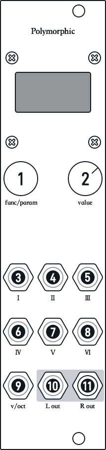
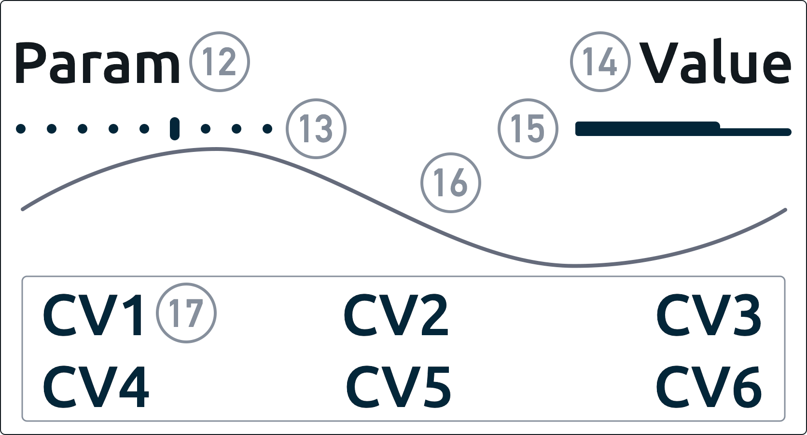

<H1>Polymorphic Digital Oscillator User Manual</H1>

Software Version v1.40 Document Update Date 2025-05-01

## I. Module Operation and Interface Details

##### Polymorphic's operating logic is based on multiple parallel oscillators and their corresponding parameter lists. You only need to understand this chapter to get started with the module easily.

<figure>

    <figcaption>Module Diagram</figcaption>
</figure>

### 1. Encoder

**Rotate directly**: Used to switch between parameters (corresponding to Param in 12. UI Interface) and switch menus. Different oscillator functions have different parameter lists.

**Press and rotate**: Used to switch between oscillator functions.

**Double-press**: Used to enter the tuning and quantization menu.

### 2. Potentiometer

**Modify parameter values**: Used to modify parameter values (corresponding to Value in 14. UI Interface). Menu values can also be modified on menu screens.

**Unlocking mechanism**: Since values have default values and previously stored values, you must turn the potentiometer close to the original value before the current parameter can be unlocked for editing. When unlocked, an \* indicator is added to the value, and the potentiometer can then actually modify the current parameter. The previous parameter value is indicated by the value bar in the upper-right corner (corresponding to the value bar in the upper-right corner of 15. UI Interface).

### 3 - 8. CV Input 1 - 6

These jacks accept external modulation signals to change the voltage-controlled parameters of the current oscillator function.

The specific parameter types are shown as six-character labels at the bottom of the screen (corresponding to CV1 - CV6 in 17. UI Interface).

### 9. VOCT Input

This jack is a volt-per-octave input used to determine the pitch of the current oscillator. It can be used with most oscillator functions and also provides the ability to select quantization in the menu.

It may serve other purposes in some oscillators without pitch.

### 10 - 11. Left and Right Oscillator Outputs

These serve as stereo outputs for some oscillator functions suitable for stereo output.

In some functions, they form part of the sound-generation chain and are used for output and modulation.

<figure>
    
    <figcaption>Module Main Screen Interface</figcaption>
</figure>

### 12. Param Parameter Name

Use 1. Encoder to switch between parameter names. Each oscillator function has a different parameter list.

You can also use 13. Index Indicator to determine the current parameter's index and the total number of parameters in the list.

### 13. Param Parameter Index Indicator

Used to determine the current parameter's index and the total number of parameters in the list.

The selected parameter is indicated by a vertical line, while unselected parameters are indicated by dots.

### 14. Value Parameter Value

For some parameters, this displays the current parameter value.

For states that cannot be represented numerically, the current parameter value may be displayed as text.

When unlocked (see 2. Potentiometer), an asterisk is added to indicate that the current parameter can be modified.

### 15. Value Parameter Value Indicator

When you switch to a new parameter and its value is locked, this indicator shows the approximate position of the previous parameter value.

After the parameter is unlocked, it also shows the relative amount of adjustment to the current parameter.

### 16. Oscilloscope

Used to visually inspect the waveform state of the current oscillator output.

Since the device has two outputs, this oscilloscope generally displays the waveform of R Out (11 in the figure).

### 17. CV Input Name 1 - 6

These labels indicate the names of the parameters modulated through jacks 3 - 8.

Different oscillator functions have different parameters and corresponding names.  

## II. Detailed Description of Each Oscillator Function

##### You can switch between oscillator functions at any time by pressing and rotating the encoder. When using a particular oscillator function, refer to the following documentation for information on its parameters and modulation.

### 1.FmDCO Dual-Operator FM Oscillator

##### param list Parameter List

**Freq**: Used to adjust the relative frequency of the current oscillator

**Octave**: Used to adjust the octave of the current oscillator. When this value is set to its minimum, the oscillator enters LFO mode

**OPFreq**: Used to adjust the operator frequency over a multiplier range of 0.5-16x

**OPLV**: Used to adjust the amount of modulation applied by the operator to the main oscillator (offset)

**Attk**: The amount of modulation applied by the operator to the main oscillator is also controlled by an envelope; this adjusts the envelope's Attack

**Decay**: The amount of modulation applied by the operator to the main oscillator is also controlled by an envelope; this adjusts the envelope's Decay

**Sustain**: The amount of modulation applied by the operator to the main oscillator is also controlled by an envelope; this adjusts the envelope's Sustain

**Release**: The amount of modulation applied by the operator to the main oscillator is also controlled by an envelope; this adjusts the envelope's Release

**WaveType**: Waveform types for the main oscillator and operator, with eight combinations in total

##### CV1-6 Modulation Parameters

**OPFreq**: Voltage-controlled OPFreq parameter

**OPLV**: Voltage-controlled OPLV parameter

**EGTrig**: Modulation envelope trigger

**Attk**: Voltage-controlled Attack parameter

**Sustain**: Voltage-controlled Sustain parameter

**Release**: Voltage-controlled Release parameter

### 2.WSDCOII Waveform Morphing Oscillator with Built-In Operator

##### param list Parameter List

**Freq**: Used to adjust the relative frequency of the current oscillator

**Octave**: Used to adjust the octave of the current oscillator. When this value is set to its minimum, the oscillator enters LFO mode

**Algorithm**: Waveform morphing algorithm, with eight algorithms in total

**Shape**: Waveform morphing offset (offset)

**OPFreq**: Used to adjust the operator frequency

**OPLV**: Used to adjust the amount of modulation applied by the operator to the main oscillator (offset)

**OPMode**: Operator frequency calculation rule. First: locked multiplier mode, 0.5-16x; second: 0-1000 Hz

**WaveType**: Waveform type of the main oscillator, with 16 types in total

##### CV1-6 Modulation Parameters

**Shape**: Voltage-controlled Shape parameter

**OPFreq**: Voltage-controlled OPFreq parameter

**OPLV**: Voltage-controlled OPLV parameter

**Sync**: Phase synchronization input; can also be used as Rst in LFO mode

**---**: None

**WaveType**: Voltage-controlled WaveType parameter

### 3.AddDCO Additive Oscillator

##### param list Parameter List

**Freq**: Used to adjust the relative frequency of the current oscillator

**Gain**: Harmonic gain amount

**Harm**: Harmonic arrangement

**Octave**: Used to adjust the octave of the current oscillator. When this value is set to its minimum, the oscillator enters LFO mode

**SideChTime**: Adjusts the attack and release times of the sidechain input on adc3 (beta)

**WaveType**: Oscillator waveform type, with eight types in total

##### CV1-6 Modulation Parameters

**AddGain**: Voltage-controlled AddGain

**Harm**: Voltage-controlled Harm parameter

**SideCh.**: Sidechain trigger; can be triggered by an audio signal

**AttenL**: Left-channel volume attenuator. Can be used with AttenR to create changing panning effects; you can also use it as an inverted VCA

**AttenR**: Right-channel volume attenuator. Can be used with AttenL to create changing panning effects; you can also use it as an inverted VCA

**WaveType**: Voltage-controlled WaveType parameter

### 4.ChordDCO Chord Oscillator

##### param list Parameter List

**Root**: Root frequency adjustment

**Chord**: Builds a chord based on the root, with 15 chord types covering major, minor, dominant, and diminished chords

**Inver**: Chord inversion arrangement

**Octave**: Used to adjust the octave of the current oscillator. When this value is set to its minimum, the oscillator enters LFO mode

**SideChTime**: Adjusts the attack and release times of the sidechain input on adc3 (beta)

**WaveType**: Oscillator waveform type, with eight types in total

##### CV1-6 Modulation Parameters

**Chord**: Voltage-controlled Chord parameter

**Inver**: Voltage-controlled Inver parameter

**SideCh.**: Sidechain trigger; can be triggered by an audio signal

**AttenL**: Left-channel volume attenuator. Can be used with AttenR to create changing panning effects; you can also use it as an inverted VCA

**AttenR**: Right-channel volume attenuator. Can be used with AttenL to create changing panning effects; you can also use it as an inverted VCA

**WaveType**: Voltage-controlled WaveType parameter

### 5.HarmonicDCO Harmonic Interval Oscillator

##### param list Parameter List

**Root**: Root frequency adjustment

**RootLV**: Root volume

**2ndNote**: Interval relationship between the second note and the root (arranged according to twelve-tone equal temperament)

**2ndLV**: Volume of the second note (offset)

**3rdNote**: Interval relationship between the third note and the root (arranged according to twelve-tone equal temperament)

**3rdLV**: Volume of the third note (offset)

**4thNote**: Interval relationship between the fourth note and the root (arranged according to twelve-tone equal temperament)

**4thLV**: Volume of the fourth note (offset)

**Octave**: Used to adjust the octave of the current oscillator. When this value is set to its minimum, the oscillator enters LFO mode

**WaveType**: Oscillator waveform type, with eight types in total

##### CV1-6 Modulation Parameters

**2ndLV**: Voltage-controlled volume of the second note

**3rdLV**: Voltage-controlled volume of the third note

**4thLV**: Voltage-controlled volume of the fourth note

**2ndWT**: Voltage-controlled waveform type of the second note, with eight types in total

**3rdWT**: Voltage-controlled waveform type of the third note, with eight types in total

**4thWT**: Voltage-controlled waveform type of the fourth note, with eight types in total

### 6.Smpl32k 32k Sampler (beta)

##### param list Parameter List

**Speed**: Playback speed

**Position**: Playback head position

**TrigMode**: Trigger mode: continuous loop or one-shot trigger

**BitCrush**: Bit-crush distortion

**SmplSelect**: Sample selection. Four fixed samples are currently available. Stay tuned for more samples and an import function

### 7.FourPerc Four-Track Percussion Trigger

##### param list Parameter List

**KickLV**: Kick volume

**KickTone**: Kick tone

**ClapLV**: Snare volume

**ClapFilter**: Snare filter

**HHLV**: Hi-hat volume

**HHDecay**: Hi-hat decay length

**PercLV**: Percussion volume

**PercFreq**: Percussion frequency

### 8.DFM_OSC East Coast Drum Oscillator

##### param list Parameter List

**EGDecay**: Pitch envelope decay setting

**OP1EGAmt**: Amount of modulation applied by the pitch envelope to oscillator 1 pitch

**OP1Freq**: Oscillator 1 frequency

**OP2FMAmt**: Amount of modulation applied by oscillator 2 to oscillator 1

**OP2EGAmt**: Amount of modulation applied by the pitch envelope to oscillator 2 pitch

**OP2Freq**: Oscillator 2 frequency

**Mix**: Volume of oscillator 1, oscillator 2, and a noise generator

**VCADecay**: Decay setting of the VCA envelope

**WaveType**: Waveform types for oscillators 1 and 2, with four combinations in total

##### CV1-6 Modulation Parameters

**Trig**: Triggers the VCA envelope; otherwise, no sound will be produced

**EGDecay**: Voltage-controlled pitch envelope decay

**OP2FMAmt**: Voltage-controlled amount of modulation applied by oscillator 2 to oscillator 1

**OP2Freq**: Voltage-controlled oscillator 2 frequency

**Noise**: Voltage-controlled noise generator volume

**VCADecay**: Voltage-controlled VCA envelope decay amount

### 9.Swarmduino Detuned Oscillator

##### param list Parameter List

**FQ**: Oscillator frequency setting

**Detune**: Degree of detuning between oscillators

**Tremolo**: Degree of variation of the detuned oscillators (equivalent to tremolo)

**Tremolo-Shape**: Variation mode of the detuned oscillators, with eight modes in total

**Octave**: Used to adjust the octave of the current oscillator. When this value is set to its minimum, the oscillator enters LFO mode

**WaveType**: Oscillator waveform type, with eight waveforms in total

### 10.Glitch Glitch Oscillator

##### param list Parameter List

**Freq**: Finely adjusts the oscillator frequency

**Tables**: Selects the waveform, with five waveforms in total

**Modulation**: Adjusts the modulation depth

**Obertone**: Sets the overtone amount

**Glitch**: Number of FM operators

##### CV1-6 Modulation Parameters

**Mod**: Voltage-controlled modulation depth

**Ober**: Voltage-controlled overtone amount

**Glitch**: Voltage-controlled number of FM operators

**---**: None

**Random**: Generates random oscillator parameters

**Trig**: Trigger; without a trigger, the oscillator will not produce sound

To be completed

## III. Module Tuning and Quantizer Settings, and Other Information

##### You can enter the tuning and quantization settings at any time by short-pressing the encoder twice in succession. Here, you can use the following documentation to make global adjustments to the oscillator. This menu also provides more information about the module.

### 1.Tune Scale Tuning

Can be used to calibrate pitch, calculated from C0 at 32.7 Hz. Affects global VOCT tuning. This parameter is retained after power-off and restart.

### 2.Tune Offset Tuning Offset

Can be used to shift pitch and affects global VOCT tuning. This parameter is retained after power-off and restart.

### 3.ScaleQuantizer Quantized Scale

Selects the scale mode for quantization and affects global VOCT quantization. Quantization is not selected by default. This parameter will also return to its default value after the next restart.

### 4.Root Note Quantization Root Note

Selects the root note of the quantization scale and affects global VOCT quantization. The default root note is C. This parameter will also return to its default value after the next restart.

### 5.Version Version Information

Displays the current module's software version information.

### 6.Modular Reboot Reboot Device

Unlock the value and adjust it to its maximum to reboot the device.

To be completed

## IV. Technical Specifications

### 1.Dimensions

128.5mm x 30.48mm

Eurorack width: 6HP

Depth: approximately 24mm

### 2.Operating Information

Uses a 10-pin power connector

Includes a reverse-polarity protection circuit

+12 V, 140 mA

-12 V, 10 mA

*Note! Powering through the USB port can also turn on the module, but it cannot properly output Eurorack-standard audio or receive CV inputs!

### 3.Operating Platform

Pico RP2040

### 4.Audio Output Technical Specifications

44.1 kHz, 16-bit; maximum level +-10 V; actual level +-7 V

### 5.Control Voltage Input Technical Specifications

Higher than 44.1 kHz, 12-bit; VOCT: 0-5 V; CV1-6 input level range: 0-10 V

### 6.Expansion Device SPI Expander(Test)

Stay tuned

