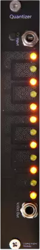
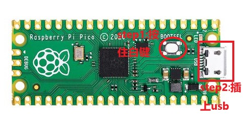

<H1>Quantizer User Manual</H1>

Software Version v1.00  Document Last Updated: 2025-12-01

## 1. Quick Start

Quantizer is a touch-controlled quantizer for modular synthesizers, with three operating modes:

**Quantization Mode** - Quantizes the CV input signal to your selected scale and outputs precise pitches

**Slide Mode** - Controls continuously varying CV output through touch position, with support for recording and playing back touch movements

**Arpeggio Mode** - Select notes by touch, trigger arpeggio playback with an external clock, and control octaves through touch pressure

The 12 touch pads at the top of the module correspond to the 12 semitones (C through B). Touching a pad toggles the enabled state of its note.

## 2. Module Operation and Interface Details

### 1. Mode Switch Button

Each press of this button cycles the module through its three operating modes:

Quantization Mode → Slide Mode → Arpeggio Mode → Quantization Mode

### 2. CV Input Jack

Accepts a control voltage input (0-10V). It serves as the input signal in Quantization Mode and Arpeggio Mode, and can be used to reset playback in Slide Mode.

### 3. Pitch Output Jack

Outputs the quantized pitch signal (0-10V) following the 1V/oct standard. It can be connected directly to the pitch input of an oscillator or another module.

### 4. Tune Knob

Fine-tunes the output pitch. Turn clockwise to raise the pitch and counterclockwise to lower it. This control is active in Quantization Mode and Arpeggio Mode.

### 5. Touch Pad Area

The 12 touch pads correspond to the 12 semitones (from left to right: C, C#, D, D#, E, F, F#, G, G#, A, A#, B) and serve different functions in each mode:

- **Quantization Mode**: Touch a pad to enable/disable its corresponding note
- **Slide Mode**: Touch position determines the output CV value; sliding gestures are supported
- **Arpeggio Mode**: Touch to select notes; touch pressure determines the playback octave

### 6. LED Indicators

The 12 LED indicators above the touch pads show the current status:

- **Quantization Mode**: A lit LED indicates that its note is enabled and will be included in quantization
- **Slide Mode**: A single LED moves with the touch position
- **Arpeggio Mode**: Lit LEDs indicate the notes currently being pressed

## 3. Detailed Function Modes

### 1. Quantization Mode

**This mode quantizes an external CV input signal to your selected scale and outputs the nearest note**

##### Basic Operation

Touch the 12 touch pads to toggle the enabled state of their corresponding notes:
- Touch once: Enable the note (LED lights up)
- Touch again: Disable the note (LED turns off)

By default, the module enables the major scale (C, D, E, F, G, A, B). You can freely combine any notes to create a custom scale.

##### Operating Principle

When a CV input signal enters the module, it is automatically matched to the nearest currently enabled note, and the corresponding pitch is output. For example:
- If only C, E, and G are enabled, the output will always be one of these three notes, regardless of the CV input value
- If all 12 notes are enabled, the output exactly matches the input (no quantization effect)

##### Tuning Function

Use the Tune knob to fine-tune the output pitch and compensate for pitch deviations in external equipment.

##### Applications

- Convert LFO or random signals into melodies
- Restrict pitches to a specific scale to ensure musical results
- Create chord progressions by outputting only the notes within each chord

### 2. Slide Mode

**This mode controls continuously varying CV output through touch position, with support for recording and playing back touch movements**

##### Basic Operation

Touch and slide across the 12 touch pads. The module outputs a CV value corresponding to the touch position:
- Touch the leftmost pad: Output the lowest voltage
- Touch the rightmost pad: Output the highest voltage
- Touch multiple pads: Calculate a weighted average position based on touch pressure

The LED indicator moves with the touch position to provide visual feedback.

##### CV Recording Function

The module has a built-in recording function that records your touch movements:

**Recording**
- When a touch is detected, recording of CV changes starts automatically
- Continuously records up to 30 seconds of touch movements

**Playback**
- After releasing your finger, the module waits approximately 300 milliseconds and then automatically enters Playback Mode
- Continuously loops the previously recorded CV curve
- If you touch again shortly after releasing, recording continues

**Reset Playback**
- In Playback Mode, apply a rising signal to the CV input jack to reset the playback head to the beginning

##### Smoothing

When you slide your finger, the output is automatically smoothed:
- Fast sliding: Rapid response with a highly responsive feel
- Slow sliding: Extremely smooth output with no jitter

##### Applications

- Control filter cutoff frequency in real time
- Create dynamic modulation envelopes
- Record and loop automated parameter changes

### 3. Arpeggio Mode

**This mode selects notes by touch, triggers arpeggio playback with an external clock, and controls octaves through touch pressure**

##### Basic Operation

**Selecting Notes**
- Touch the 12 touch pads to select the notes included in the arpeggio
- Touch multiple pads simultaneously to create chord arpeggios

**Pressure Controls Octaves**
- The greater the touch pressure, the higher the playback octave
- Minimum pressure plays the lowest octave (C0)
- Maximum pressure plays the highest octave (C9)

**Clock Triggering**
- Apply a clock signal to the CV input jack (rising-edge triggered)
- Each clock pulse plays the next selected note
- After all selected notes have been played, the sequence loops from the beginning

**Last Note Hold**
- After all pads are released, the module continues playing the last note released
- This continues until a new clock signal is received or a pad is touched again

##### Applications

- Create dynamic arpeggiated melodies
- Add melodic layers through pressure variations
- Work with an external sequencer to create complex chord progressions

## 4. Technical Specifications

### 1. Dimensions

| Item          | Specification     |
|---------------|-------------------|
| Overall Dimensions | 128.5mm x 20.32mm |
| Eurorack Width | 4HP               |
| Depth         | Approx. 46mm      |

### 2. Operating Information

| Item          | Specification                     |
|---------------|-----------------------------------|
| Power Connector | 10-pin power connector          |
| Protection Circuit | Reverse-polarity protection circuit included |
| +12V Current Draw | 60 mA                        |
| -12V Current Draw | 10 mA                        |
| Operating Platform | Pico RP2040                  |

Note: The module can be powered on through the USB port, but it cannot properly output standard Eurorack levels or receive CV input! The module power supply must be connected for normal voltage input and output!

### 3. Voltage Output Specifications

| Item          | Specification     |
|---------------|-------------------|
| Sampling Rate | 8 kHz             |
| Resolution    | 12-bit            |
| Output Level Range | 0-8V         |

### 4. Control Voltage Input Specifications

| Item          | Specification     |
|---------------|-------------------|
| Sampling Rate | 8 kHz             |
| Resolution    | 12-bit            |
| Input Level Range | 0-10V        |

### 5. Touch Control Specifications

| Item          | Specification     |
|---------------|-------------------|
| Touch Channels | 12 channels      |
| Pressure Detection | Supported    |
| Sampling Frequency | 2 kHz        |

## 5. Firmware Update

<figure>

    <figcaption>Firmware update steps: Hold down the Boot button and connect the USB cable</figcaption>
</figure>

Visit https://environscape.github.io/CodingInspire/support.html for the latest firmware information.

Before connecting the USB cable to your computer, press and hold the Boot button on the Pico RP2040, then connect the USB cable to the computer. A new disk drive will appear on your computer. Drag the downloaded UF2 firmware file into this drive and wait for one minute. Then disconnect the USB cable directly. Your Quantizer module has now been updated.
